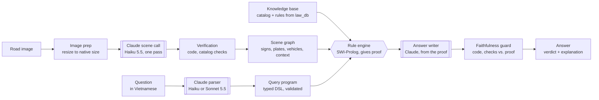

# Neuro-Symbolic Traffic Sign VQA — System Design

Nov 14, 2026 · @Nam

## Goals, scope and assumptions

The system answers natural-language questions about a road image ("Can I turn left here on a motorbike?", "What is the speed limit for cars?") by turning the image and the question into symbols and letting a rule engine decide. Claude does the perception-to-symbol and language work. The rule engine owns every legal conclusion, so each answer can be traced to a sign and a rule.

**Goals**

- Correct, explainable answers: every answer cites the detected signs and the rules that fired.
- Faithfulness: the final answer never contradicts the rule engine's conclusion.
- Honest uncertainty: when a sign is unreadable or the rules don't cover a case, the system says so instead of guessing.
- Measurable: a held-out benchmark with per-module and end-to-end metrics.

**In scope (v1):** single still images and Vietnamese questions, matching the VLSP2025-MLQA-Natural dataset (section 8): true/false claims, permission, lanes by vehicle or speed, time-conditional bans, sign identity and meaning, placement rules, and violations visible in the scene. Answers are in Vietnamese, in the dataset's style.

**Out of scope (v1):** video and tracking, traffic lights and road markings (planned for v2), real-time driving use. This is a research and education tool, not a driving aid.

**Legal basis:** QCVN 41:2024/BGTVT (road signs, in force since 1 January 2025, [source](https://news.laodong.vn/lai-xe-an-toan/giai-ma-nhung-bien-bao-giao-thong-it-nguoi-biet-1482017.ldo)) and Law 36/2024/QH15 on road traffic order and safety. Both are provided as the dataset's `law_db`. A replacement for QCVN 41:2024 is being drafted ([source](https://vietnamnews.vn/society/1802034/draft-road-sign-rules-add-ev-symbol-speed-based-warning-distances.html)), so the rule base carries a version tag.

## Architecture overview



Double-bordered boxes are Claude API calls; the rule engine is the only part that decides the answer.

Two paths meet at the rule engine: the image becomes a scene graph, and the question becomes a query program. Claude works in three places (reading the scene, parsing, wording the answer), but only the engine's verdict can reach the user, and a code check enforces that.

## Perception: one Claude call per image

One vision call per image returns the whole scene graph: every sign with its catalog code, the text and numbers on it, its plates, and what it looks like and where it sits. Signs in the dataset are not tiny, and an early Haiku 5.5 test found all the needed signs, so v1 starts with one pass. Two-pass cropping stays as a fallback, used only if the evaluation shows it is needed.

**The scene call**

- Input: the image, resized to the model's native size so any pixel boxes map straight back onto it ([coordinates guide](https://platform.claude.com/docs/en/build-with-claude/vision-coordinates)).
- A cached system prompt holds the sign catalog: every code with its Vietnamese name and a short visual description. Pictograms from the corpus's own `law_db/images.fld` can be added for codes that get confused.
- Structured output (JSON schema) with `code` as an enum of catalog codes plus `UNKNOWN`, so Claude can only name a real sign or admit it can't tell.
- Per sign, Claude returns:
  - the code and any numbers or text it reads (speed limits, weight limits, time windows, "ngày chẵn")
  - plates and which sign each belongs to
  - shape, border and background colour
  - position: order from top to bottom, side, which lane it covers on a lane-speed board, and a pixel box for debugging
- Questions often name a sign by how it looks ("biển viền đỏ, nền trắng ở trên cùng", "biển tròn màu xanh"). These attributes are what let the parser point at the right sign.
- Road context and vehicles are part of v1: lanes and lane markings, intersection, and for each visible vehicle its class, lane, and what it appears to be doing (driving, turning, stopped, parked, crossing a line). These are needed for the violation questions (about 6% of the private test). A still image can't show every action, so `action: unknown` is allowed, and the engine then answers `unknown` rather than guessing.

**Model choice:** start with Haiku 5.5, the cheapest. Run the same calls with Sonnet 5.5 and Opus 5.5 on the public test and keep the cheapest model that meets the perception gate in the roadmap.

**Verification (deterministic code)**

- Unknown codes rejected; values checked for plausibility per code (speed values from a fixed set, weights positive).
- Each plate attached to the sign directly above it; lane-board values attached to lanes in left-to-right order.
- Low-confidence signs: re-run the call once. Agreement → keep. Disagreement → keep both as alternatives, and the rule engine answers `uncertain` if they lead to different answers.

**Fallback: two-pass crops.** If sign recall or code accuracy on the public test misses the gate, first for dense boards or distant signs, switch those images to two passes. Pass 1 finds boxes, then each sign is cropped from the original image and read up close. It costs more calls, so it is used only where one pass fails.

## Symbolic scene graph

The scene graph is the contract between the neural side and the symbolic side: perception writes it, the rule engine reads only it. Keep it small, typed and versioned, and define it once as a Pydantic model so the same definition makes Claude's JSON schema and the rule engine's facts.

```json
{
  "scene_id": "private_test_7_9",
  "schema_version": "1.1",
  "road": {"type": "urban", "lanes": 3, "intersection_ahead": false},
  "signs": [
    {
      "id": "s1", "code": "P.125", "confidence": "high",
      "shape": "circle", "border": "red", "background": "white",
      "position": {"rank_top_down": 1, "side": "right"},
      "plates": []
    },
    {
      "id": "s2", "code": "P.127", "value": 50, "unit": "km/h", "confidence": "high",
      "shape": "circle", "border": "red", "background": "white",
      "position": {"rank_top_down": 2, "side": "right", "lane": 3},
      "plates": [{"text": "6h-22h", "time_window": ["06:00", "22:00"]}]
    }
  ],
  "vehicles": [{"id": "v1", "class": "truck", "lane": 2, "action": "overtaking", "target": "motorbike", "confidence": "medium"}],
  "context": {"datetime": null, "weather": "clear"}
}
```

As facts for the rule engine this becomes, for example: `sign(s1, p127)`, `value(s1, 50)`, `plate_time(s1, 6, 22)`, `sign(s2, p123a, 0.71)`, `alt(s2, p123b, 0.22)`. Unknowns stay unknown (`time_of_day = null`), and the engine must treat them as open, never as false.

## Knowledge base and rule engine

**Decision: SWI-Prolog**, called from Python through its `janus` bridge. A small meta-interpreter returns a proof tree with every answer, and that proof becomes both the explanation and the citation.

Why it fits better than clingo (ASP) for this project:

- **Proofs come almost free.** Each answer needs the rules and articles it used, for the explanation and the citation metric. In Prolog that's a 20-line meta-interpreter; clingo needs extra tooling to explain an answer.
- **The questions are checks, not searches.** Almost every question asks whether one fact holds ("is X permitted at time T for vehicle V?"). That's what Prolog's goal-directed querying is built for. ASP's strength, finding combinations, isn't needed.
- **Exceptions still work.** "Forbidden unless exempted" is plain negation-as-failure (`\+ exempted(...)`), which Prolog has.
- **Uncertain readings stay simple.** Python runs the query once per alternative sign reading and compares the answers, so no special logic is needed.
- **Easier for a capstone:** Prolog has many more tutorials, plus date and time libraries for rules like even-day parking bans.

Switch to clingo only if rule interactions become hard to keep consistent, for example many overlapping priorities. The rules are plain logic, so moving them would mean rewriting syntax, not redesigning.

**Three layers of knowledge**

1. **Sign catalog** (data, YAML or CSV): code, Vietnamese name, English name, category (prohibitory, mandatory, warning, information, auxiliary), effect, parameters (value, unit), and which vehicle classes it applies to. About 150 to 200 rows for v1.
2. **Domain ontology** (Prolog facts): vehicle hierarchy (`is_a(motorbike, motor_vehicle)`), action hierarchy (`is_a(u_turn, turning)`), road types and their default speed limits.
3. **Rules** (Prolog clauses): what each sign permits, forbids or requires, plus how rules combine.

```prolog
% A prohibitory sign forbids an action for a vehicle class
forbidden(Action, Vehicle, Scene, because(S, Rule)) :-
    active_sign(S, Code, Scene),
    prohibits(Code, Action, Classes),
    applies_to(Vehicle, Classes),
    \+ exempted(S, Vehicle, Scene),
    Rule = rule(prohibits, Code).

% Auxiliary plate restricts a sign to a time window
active_sign(S, Code, Scene) :-
    sign(S, Code, Scene),
    (   plate_time(S, From, To)
    ->  scene_time(Scene, T), between_hours(T, From, To)
    ;   true ).

permitted(Action, Vehicle, Scene) :-
    \+ forbidden(Action, Vehicle, Scene, _).
```

**Rules the engine must handle explicitly**

- Signal priority: the regulation defines an order of effectiveness across police instructions, lights, signs and markings ([source](https://lawnet.vn/thong-tin-phap-luat/en/thong-bao-van-ban-moi/update-of-qcvn-41-2024-bgtvt-on-road-signaling-in-vietnam-174382.html)). Encode it as one rule, even though v1 only sees signs.
- Scope: when a restriction starts and ends ("end of restriction" signs, the next intersection).
- Vehicle-specific limits: the same speed sign can carry different values per vehicle class on a plate.
- Three-valued answers: `yes`, `no` or `unknown`. If the time of day is unknown and a plate has a time window, the answer is "depends on time" plus the window, never a guess.
- Uncertain readings: run the query on each alternative reading. If every reading gives the same answer, return it; if they differ, return `uncertain` and name the sign that needs checking.

**Authoring from `law_db`:** the sign catalog comes from the QCVN 41:2024 appendix articles (for example B.1 describes P.101 "Đường cấm"). Behaviour rules (overtaking, lanes, stopping and parking, priority) come from QCVN 41 and Law 36/2024/QH15. Claude (Opus 5.5) drafts rows and clauses from the article text, and a person checks each one. Every rule stores its `source` as `law_id` + `article_id`, the same format as the dataset's `relevant_articles`, so citations can be scored directly on train. The most-cited train articles are a good build order: QCVN 41 articles 22, 32, 47, B.27, 28, 41 and 36.

**Violations (v1):** a violation is a rule an observed vehicle breaks: `violation(V, Rule) :- vehicle(V, Class, Lane, Action), forbidden(Action, Class, Scene, Rule)`. The same permission rules cover both "may I?" questions and "is anyone breaking a rule?" questions. Start with the violation types that appear in train and public (wrong lane, banned turn or U-turn, stopping or parking under a ban, overtaking under a ban), and add others only when the data needs them.

## Question parsing

Claude turns the user's question (in Vietnamese) into a small typed query program. It never answers the question at this stage. The parser sees only the question and the list of sign codes in the scene, not the image, so it can't slip in its own visual reading.

**Query DSL (schema 1.2), built from the dataset's question types**

| Intent | Example from the data | Program |
| --- | --- | --- |
| verify a claim | "Vào lúc 8 giờ ngày 2/9/2025, xe ô tô con … được phép rẽ trái. Đúng hay sai?" | `verify(permitted(turn_left, passenger_car, when=(2025-09-02, 08:00)))` |
| ban over a time window | "Xe ô tô không được phép di chuyển trên đoạn đường này trong khung giờ từ 6:00 đến 22:00, đúng hay sai?" | `forbidden(enter, car, when=(06:00..22:00, all))` |
| permission | "Biển cấm xe máy trong ảnh có cho phép xe ba bánh đi qua không?" | `permitted(enter, motor_tricycle, sign=select(meaning=no_motorbikes))` |
| lane by vehicle | "Xe tải có khối lượng chuyên chở 3,4 tấn được đi ở làn nào?" | `lanes_for(truck(load_t=3.4))` |
| lane by speed | "Ô tô chạy 65 km/h không được sử dụng làn nào?" | `lanes_where(car, 65, ok=false)` |
| value | "Xe khách trên 29 chỗ bị cấm vào những khoảng thời gian nào?" | `ban_times(coach(seats_gt=29))` |
| choice | "Trong các mức 30, 35, 40 và 45 km/h, mức nào vi phạm?" | `choose([{label: "45 km/h", claim: speed_ok(motor_vehicle, 45), expect: false}, ...])` |
| choice over a window | "Xe có trọng tải 500 kg, 1 tấn, 1,5 tấn và 2 tấn, trường hợp nào không được lưu thông từ 6 giờ đến 21 giờ?" | `choose([{label: "2 tấn", claim: forbidden(enter, truck(gross_t=2), when=(06:00..21:00, all))}, ...])` |
| identity / meaning | "Đây là biển báo gì?" | `meaning(select(only))` |
| placement and scope | "Nếu biển đặt sau nơi đường giao nhau, có bắt buộc rẽ phải ngay không?" | `required(turn_right, placement=after_intersection)` |
| violation | "Trong hình không phát hiện hành vi vi phạm, đúng hay sai?" | `verify(exists_violation, expect=false)` |
| sign identity | "Đây là biển báo cấm vượt. Đúng hay sai?" | `is_sign(select(only), meaning=no_overtaking)` (or `code=P.125`, or `category=prohibitory`) |
| compound claim | "Các loại xe được dừng và đỗ vào lúc 12 giờ trưa đúng hay sai?" | `verify(all_of([permitted(stop, vehicle, 12:00), permitted(park, vehicle, 12:00)]))` |
| which vehicles | "Đối tượng nào không được phép đi lại trên phần đường này?" | `which_vehicles(enter, status=banned)` |
| lane by vehicle, lane slot | "Xe ô tô đi vào 2 làn bên phải lúc 10 giờ có bị phạm luật không?" | `forbidden(enter, car, lane=3, when=10:00)` |
| vehicles on a lane | "Làn bên trái dành cho những xe nào?" | `lane_vehicles(lane=1, status=allowed)` |
| speed limit value | "Tốc độ tối đa trên cả 3 làn đường là bao nhiêu?" | `speed_limit(motor_vehicle, kind=max)` (per lane when there is a lane board) |

The pieces the table uses:

- **Selectors** resolve against the scene graph: by appearance and position (`select(border=red, background=white, position=top)`), by code, or by meaning. A meaning is a catalog `key` (`no_motorbikes`) or tag (`speed_limit`).
- **Vehicles** are a class plus attributes. An attribute is exact (`load_t=3.4`) or bounded by strict comparisons (`seats_gt=29`, `load_lt=2`, `gross_gt=1.5`), never both. "xe 4 bánh thô sơ" is `similar_rudimentary`, our interpretation of Law 36 art. 34(2)(e) ("xe tương tự"); proofs cite it as an interpretation.
- **Times** carry a full date when known, so rules like "cấm đỗ ngày chẵn" (no parking on even days) can be checked.
  - `when` is a moment or an interval `start..end`. An interval may run past midnight; after midnight the next day's date is used.
  - An interval needs a quantifier that applies to what the program states: `all` means it holds at every moment, `any` at some moment.
  - `forbidden(..., when=(a..b, all))` is "banned for the whole window", and `any` is "banned at some point in it".
  - `forbidden` compiles to `verify(permitted(...), expect=false)` with the quantifier flipped, so the parser never writes the double negative.
- **`choose`** returns the options that hold (an option holds when its claim's answer matches `expect`), the ones that don't, and the unknown ones.
- **`required`** uses the placement the question gives, else the sign's placement in the scene, else its standard placement from QCVN 41 D.1a.
- **`is_sign`** checks the selected sign against a catalog code, meaning or category. A family code ("W.221") matches its variants, and the proof cites the actual sign's article.
- **`all_of` / `any_of`** combine claims with three-valued AND/OR.
- **`which_vehicles` and `lane_vehicles`** check every vehicle class. They report the broadest class that holds as a whole (P.104 → motorbike), plus conditional classes whose answer depends on their own attributes (P.106b → truck).
- **`speed_limit`** returns the binding limit (the lowest certain maximum), plus stricter limits that may apply.

Every answer comes with a proof and citations, including "yes" answers:

| Answer | What its proof shows |
| --- | --- |
| "no" | the sign that forbids |
| "yes" | each relevant sign and why it does not apply (vehicle not covered, excepted, outside its time window, wrong day, ...) |
| "unknown" | what it depends on |

In the scene graph, a sign whose plate or board lists several (vehicles, time window) pairs carries them as condition groups (`Sign.rules`). The sign applies when one group matches both the vehicle and the time.

A non-standard plate (not in QCVN 41, e.g. a red local text plate) is a plate of kind `local`:
- its text is kept verbatim;
- the vehicles and actions read from it replace the main sign's own;
- its times and condition groups work like standard plates.

The proof shows the plate and is marked "not in QCVN 41", and the answer carries `basis: ["non_standard_plate"]`.

**Implementation**

- One Claude call with structured output. The schema is a JSON form of the DSL, and its enums (actions, vehicle classes, attributes) come from the ontology, so Claude can only use terms the rule engine knows.
- Vehicle classes follow the law's own categories, plus attributes (load in tonnes, seats). "xe lam", "xe ba bánh" and "xe tải 3,4 tấn" all map to a class plus attributes.
- `missing_slots` and `out_of_scope` fields; if the vehicle is missing, answer for each relevant class.
- Model: Haiku 5.5 or Sonnet 5.5, with the DSL spec and reviewed train examples in a cached system prompt.
- Gold intents come from the annotation step in section 8. Program accuracy is measured on public and private.

## Grounded answer generation

Claude only *verbalizes* the rule engine's conclusion; it doesn't re-decide it. The engine returns a verdict plus a proof, and Claude writes a short answer in the user's language that states the verdict and explains it from the proof.

**Input to Claude:** the question, the verdict (`yes` / `no` / `unknown` / `uncertain` / a value), the proof tree (signs used, rules fired, rule sources), and the uncertainty flags. No image.

**Output (structured):** `{"verdict": "no", "answer": "...", "cited_signs": ["s2"], "cited_rules": ["r_p123a"]}`

**Faithfulness guard (code, after the call):**

- `verdict` must equal the engine's verdict exactly, or the answer is regenerated.
- Every cited sign and rule must appear in the proof.
- A cheap check that the text contains no sign codes or numbers missing from the proof (catches invented speed values).

**Example and style.** Question: "Biển cấm xe máy trong ảnh có cho phép xe ba bánh đi qua không?" Engine: `no`, because the rule for this prohibition sign covers three-wheelers too. Answer: "Không được phép. …" plus one short reason citing the sign. True/false questions are answered "Đúng" or "Sai" first, then the reason, so the Yes/No scorer can read them.

## Data and benchmark

The project uses VLSP2025-MLQA-Natural, a free-answer version of the VLSP 2025 MLQA-TSR task ([paper](https://aclanthology.org/2025.vlsp-1.48/)). Its private test is the benchmark. The dataset has gold answers only; gold signs and gold query programs are added as described below.

| Split | Questions | Images | Yes/No · Natural QA | Gold citations | Role in this project |
| --- | --- | --- | --- | --- | --- |
| Train | 530 | 304 | 154 · 376 | yes (`relevant_articles`) | build rules and prompts, few-shot examples, citation check |
| Public test | 100 | 90 | 37 · 63 | no | development set: tune and choose models |
| Private test | 146 | 104 | 70 · 76 | no | final benchmark, run once at the end |

**Law corpus (`law_db`):** QCVN 41:2024/BGTVT (313 articles, including the sign appendices such as B.1 = P.101 "Đường cấm") and Law 36/2024/QH15 on road traffic order and safety (89 articles). Images referenced by the articles are in `images.fld`. This is the source for the sign catalog, the rules and their citations (section 5).

**What the private test asks** (keyword estimate, so categories overlap):

| Question feature | Private | Public | Train |
| --- | --- | --- | --- |
| True/false claim ("đúng hay sai") | 47% | 36% | 28% |
| Names a vehicle class | 41% | 27% | 20% |
| Turn, U-turn, stop, park, overtake | 27% | 17% | 16% |
| Speed | 24% | 14% | 13% |
| Lanes | 15% | 8% | 7% |
| Time or date | 13% | 8% | 7% |
| Sign identity or meaning | 8% | 28% | 24% |
| Weight or seats | 8% | 4% | 3% |
| Violation in the scene | 6% | 1% | 2% |

The private test leans toward reasoning (claims, lanes, times, vehicle classes) rather than naming signs. That suits the rule engine, and it means the train split under-represents some private question types. Keep that in mind when choosing few-shot examples.

**Gold annotations to add**

1. **Gold signs:** label the signs (code, value, plates, position) on the 90 public and 104 private images by hand, with Claude pre-filling and a person correcting. Sign lists only, no boxes. For images with violation questions, also list the vehicles and what they are doing.
2. **Gold intents:** Claude (Opus 5.5) drafts the query program for every question in all three splits, and a person reviews each one. Train programs become few-shot examples; private programs are used only to score the parser.
3. **Hold-out rule:** design rules, prompts and models on train and public only. Labelling private-test signs and programs is fine for per-module scoring, but don't change the system after looking at private results.

**Usage notes from the dataset README:** only the image and question go to the model; `provenance.json` and `review.json` must stay out of prompts; `train_284` has an invalid citation; and the original VLSP data agreement applies.

## Evaluation

The headline number is answer accuracy on the private test, split into Yes/No and Natural QA. Every module is also scored on its own, so each wrong answer can be traced to the stage that caused it.

**Scoring the answers.** Gold answers are free Vietnamese text, so exact match won't work.

- **Yes/No (70 private):** map both prediction and gold to true/false (Đúng, ĐÚNG, đúng, Có, Được → true; Sai, SAI, Không, Không được phép → false), then exact match. Fully automatic.
- **Natural QA (76 private):** an LLM judge (Opus 5.5) compares the prediction with the gold answer for the key facts (code, number, lane, time, vehicle), and returns correct / partly correct / wrong. A person also scores every private Natural QA answer from the final system and the strongest baseline, without seeing the judge's verdict. Report both scores and how closely they agree (Cohen's kappa).
- Use the same judge prompt and model for the system and every baseline.

| Stage | Metric | Gold |
| --- | --- | --- |
| Perception | sign recall, sign-code F1, value and plate accuracy | gold sign lists (public, private) |
| Question parser | program exact match, slot F1 | reviewed gold intents |
| Rule engine | answer accuracy with gold scenes and gold programs (should be close to 100%) | unit tests + gold annotations |
| Citations | proof sources vs. `relevant_articles` | train only |
| End to end | Yes/No accuracy, Natural QA judge score, results by question feature (section 8 table) | dataset answers |
| Cost and speed | USD and seconds per question | API logs |

**Baselines (same judge, same splits)**

- Claude alone: image + question to Haiku 5.5, Sonnet 5.5 and Opus 5.5, no rules.
- Claude + retrieval: the same, plus the most relevant law articles retrieved from `law_db`. This is the usual approach for this task, and the closest competitor.
- Pipeline with gold perception and gold programs: shows how much error comes from vision and parsing rather than reasoning.

**Ablations:** Haiku vs. Sonnet vs. Opus for the scene call; with vs. without reference pictograms; one pass vs. the two-pass fallback on the images where one pass failed.

## Tech stack, repo layout and cost control

| Layer | Choice |
| --- | --- |
| Language | Python 3.11+ |
| Image handling | Pillow: resize to Claude's native size (crops only for the fallback) |
| Perception | Claude vision only: one scene call per image (Haiku 5.5 first); no local models to train |
| Claude API | `anthropic` Python SDK; `claude-sonnet-5-5`, `claude-haiku-5-5`, `claude-opus-5-5` |
| Schemas | Pydantic v2 (also makes the JSON schemas for structured outputs) |
| Rule engine | SWI-Prolog + `janus` (or clingo) |
| API and demo | FastAPI + Gradio or Streamlit |
| Tests and eval | pytest, a small eval runner writing CSV/JSON results |

```text
traffic-vqa/
  kb/                 # sign_catalog.yaml, ontology.pl, rules/*.pl (versioned, each rule has a source)
  vqa/
    schemas.py        # SceneGraph, QueryProgram, Answer (Pydantic)
    perception/       # scene.py (one call per image), verify.py, crops.py (fallback)
    parsing/          # claude_parser.py, dsl.py, validator.py
    reasoning/        # engine.py (janus bridge), explain.py (proof -> JSON)
    answer/           # claude_answer.py, faithfulness.py
    pipeline.py       # one function: answer(image, question) -> Answer
  prompts/            # system prompts + few-shot examples (cached)
  data/               # raw/, annotations/, benchmark/
  eval/               # run_eval.py, metrics.py, baselines.py
  tests/              # one test file per rule family
  app/                # FastAPI + demo UI
```

**Keeping API cost down** (API usage is billed separately from your Pro plan)

- Cache perception per image: every question about one image reuses the same scene call (the private test has 146 questions on 104 images). Perception is now the biggest cost, so measure it first.
- Use prompt caching for the long, fixed system prompts (DSL spec, schema, few-shot examples).
- Cheapest model per job: Haiku or Sonnet for parsing and answering, Haiku for the scene call unless the public test shows it isn't accurate enough; Opus only as the answer judge. An image costs about width × height / 750 tokens, so never send one larger than the model's native size.
- Run benchmark evaluation through the Message Batches API (asynchronous and discounted), not live calls.
- Log tokens and cost per stage from day one.

**Budget check: $50 a month is enough** if Haiku 5.5 handles the scene call and Opus is used only for one-off batch jobs. API prices: Haiku 5.5 $0.10 / $0.50, Sonnet 5.5 $2 / $10, Opus 5.5 $4 / $20 per million input / output tokens, with the Batch API at half price ([Claude pricing](https://platform.claude.com/docs/en/about-claude/pricing)).

| Item | Model | Estimate |
| --- | --- | --- |
| Gold sign pre-fill, 194 public + private images (batch) | Opus 5.5 | ~$4 |
| Gold intent drafts, all 776 questions (batch) | Opus 5.5 | ~$3.50 |
| Scene-model comparison on public (one run each) | Haiku, Sonnet, Opus | ~$4 |
| Development runs on public, about 40 runs | Haiku 5.5 | ~$5 (up to ~$15 with some Sonnet runs) |
| Baselines on public + private: alone and with retrieval (batch) | Haiku, Sonnet, Opus | ~$12.50 |
| Final private run + Opus judge | Haiku + Opus | under $1 |
| **Total** |  | **~$30–40, leaving a buffer** |

Assumptions: about 1,600 tokens per image, a 15,000-token sign catalog served from the prompt cache, and about 800 output tokens per scene. Where the money goes:

- One Opus scene run on public costs about $2.40, against $0.11 for Haiku. If Haiku misses the perception gate, use Sonnet (about $1.20 per run) and cut development runs to stay under $50.
- Re-run perception only when the scene prompt changes. Parser and answer changes reuse cached scenes, and those calls cost fractions of a cent.
- Write code and draft rules in the Claude app or Claude Code on your Pro plan, which is billed separately from the API, and set a $50 monthly spend limit in the Claude Console.

## Roadmap

Build from the symbolic core outward. The rule engine can be tested with no neural parts at all, and every later phase plugs into a contract that already works.

1. **Contracts and KB core (weeks 1–2).** Pydantic schemas, sign catalog for about 40 common signs, ontology, first rule families, pytest suite. *Gate:* hand-written scene graphs + programs give correct answers and proofs.
2. **Question parser (week 3).** DSL, Claude parser with structured outputs, validator. *Gate:* ≥ 90% program accuracy on the reviewed public-test intents.
3. **Perception v1 (weeks 4–5).** Sign catalog from law_db, the one-pass scene call, verification, and gold sign labels for the public and private images. *Gate:* sign recall ≥ 0.90 and sign-code F1 ≥ 0.85 on the public test; below that, turn on the two-pass fallback for the failing images.
4. **Answering and end-to-end pipeline (week 7).** Answer generation, faithfulness guard, `answer(image, question)` API. *Gate:* faithfulness ≥ 99% on dev.
5. **Benchmark and evaluation (weeks 8–9).** Freeze the system, then run the private test once as the benchmark: baselines, ablations, and error analysis by stage and question feature.
6. **Extend (week 10+).** Grow the catalog to the full sign set, add plates and hard cases, then traffic lights and road markings (v2), then a demo UI.

The weeks assume one person part-time; the gates matter more than the dates.

## Decisions

| Question | Decision | Where it shows up |
| --- | --- | --- |
| Rule engine | SWI-Prolog with the `janus` Python bridge | Section 5 |
| Natural QA scoring | LLM judge (Opus 5.5) on everything, plus human scoring of the final private run; report agreement | Section 9 |
| Gold signs | Sign lists only, no boxes (plus vehicles on violation images) | Section 8 |
| Violation questions | In v1: the scene graph models vehicles and behaviour | Sections 3, 4, 5 |
| API budget | $50 a month; Haiku 5.5 for the scene call, Opus only for batch jobs and judging | Section 10 |
| Benchmark | The natural version only; the private test is the final benchmark | Section 8 |

## Sources

- [VLSP 2025 MLQA-TSR (ACL Anthology)](https://aclanthology.org/2025.vlsp-1.48/)
- [QCVN 41:2024/BGTVT in effect from 1 Jan 2025 (Lao Động)](https://news.laodong.vn/lai-xe-an-toan/giai-ma-nhung-bien-bao-giao-thong-it-nguoi-biet-1482017.ldo)
- [Update of QCVN 41:2024/BGTVT (LawNet)](https://lawnet.vn/thong-tin-phap-luat/en/thong-bao-van-ban-moi/update-of-qcvn-41-2024-bgtvt-on-road-signaling-in-vietnam-174382.html)
- [Draft regulation to replace QCVN 41:2024 (Việt Nam News)](https://vietnamnews.vn/society/1802034/draft-road-sign-rules-add-ev-symbol-speed-based-warning-distances.html)
- [Structured outputs (Claude docs)](https://platform.claude.com/docs/en/build-with-claude/structured-outputs)
- [Vision and image limits (Claude docs)](https://platform.claude.com/docs/en/build-with-claude/vision)
- [Coordinates and bounding boxes (Claude docs)](https://platform.claude.com/docs/en/build-with-claude/vision-coordinates)
