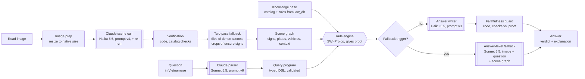

# Neuro-Symbolic Traffic Sign VQA — System Design

Nov 14, 2026 · @Nam

## Goals, scope and assumptions

The system answers natural-language questions about a road image ("Can I turn left here on a motorbike?", "What is the speed limit for cars?") by turning the image and the question into symbols and letting a rule engine decide. Claude does the perception-to-symbol and language work. The rule engine owns every legal conclusion, so each answer can be traced to a sign and a rule.

**Goals**

- Correct, explainable answers: every answer cites the detected signs and the rules that fired.
- Faithfulness: the final answer never contradicts the rule engine's conclusion.
- Honest uncertainty: when a sign is unreadable or the rules don't cover a case, the system says so instead of guessing.
- Measurable: a held-out benchmark with per-module and end-to-end metrics.

**In scope (v1):** single still images and Vietnamese questions, matching the VLSP2025-MLQA-Natural dataset (section 8): true/false claims, permission, lanes by vehicle or speed, time-conditional bans, sign identity and meaning, placement rules, and violations visible in the scene. Answers are in Vietnamese, in the dataset's style.

**Out of scope (v1):** video and tracking, traffic lights and road markings (planned for v2), real-time driving use. This is a research and education tool, not a driving aid.

**Legal basis:** QCVN 41:2024/BGTVT (road signs, in force since 1 January 2025, [source](https://news.laodong.vn/lai-xe-an-toan/giai-ma-nhung-bien-bao-giao-thong-it-nguoi-biet-1482017.ldo)) and Law 36/2024/QH15 on road traffic order and safety. Both are provided as the dataset's `law_db`. A replacement for QCVN 41:2024 is being drafted ([source](https://vietnamnews.vn/society/1802034/draft-road-sign-rules-add-ev-symbol-speed-based-warning-distances.html)), so the rule base carries a version tag.

## Architecture overview



Double-bordered boxes are Claude API calls.

Two paths meet at the rule engine: the image becomes a scene graph, and the question becomes a query program.
- **When the rules answer,** only the engine's verdict reaches the user. Claude writes the words, and a code check enforces that the words match the verdict.
- **When the rules can't answer** (the question is out of scope, it can't be parsed, the engine says unknown, or the sign readings disagree), the answer-level fallback answers from the image instead (phase 4). It is marked `basis: ["fallback"]` and carries no rule citation.
- On public_holdout the fallback answered 49% of the questions (section 7).

The fallback runs only on images whose pass-1 scene triggers it: 5 or more signs, or a `low` / `UNKNOWN` sign (phase 3).

## Perception (built in phase 3)

Phase 3 built perception and ran its gate twice on public_dev. **The gate failed both times.** Under the policy fixed before the second checkpoint, phase 4 uses Haiku 5.5 with prompt v4 plus the two-pass fallback, and the gate is recorded as failed. The figures are under "Results" below. The plan and its decisions are in `docs/plans/phase-3.md`; the record of each step is in `docs/status.md`.

**What phase 3 changed from the original design:**
- the scene call replies in plain JSON checked in Python, not with a JSON schema;
- the prompt carries reference pictograms from `law_db`, under a dataset-rule exception;
- the two-pass fallback became tiles for dense scenes plus crops for unsure codes, and it is on for every image whose pass-1 scene triggers it;
- the gate is measured on public_dev only, not the whole public test.

### The scene call (pass 1)

- **Image prep** (`vqa/perception/image.py`):
  - EXIF orientation applied, converted to RGB, resized so the long edge is at most 1568 px and the area at most about 1.15 MP, never upscaled;
  - the scale factor is kept, so a box on the sent image maps back onto the original ([coordinates guide](https://platform.claude.com/docs/en/build-with-claude/vision-coordinates));
  - the image's identity is the sha256 of the original file's bytes. The file name is never used.
- **One call per image.** Haiku 5.5 at its default (medium) effort; Sonnet 5.5 was run for comparison.
- **Plain JSON, no schema** (plan D4).
  - A `code` enum over the 219 catalog rows plus the scene's optional fields would exceed the API's strict-schema limits (24 optional and 16 union-typed parameters per request), as the parser's schema did.
  - The reply is one JSON object, bare or in a ```json fence. `vqa/perception/wire.py` checks it against the catalog and the enums in `vqa/schemas.py`; a variant code ("W.207c") resolves to its family row.
  - Malformed JSON or a failed check gets **one retry that sends only the error**. The rejected reply is not echoed back: the assistant turn is a placeholder.
  - A code still invalid after the retry becomes `UNKNOWN`, and the raw reading is kept beside the scene, not in it.
  - A refusal or a reply cut off at `max_tokens` is an error, with no retry.
- **What the model returns per sign:**
  - the code or `UNKNOWN`, a confidence, and at most one alternative reading;
  - value and unit, and the text it reads;
  - shape, border and background;
  - rank top-down, side, lane, placement, and a pixel box;
  - plates, condition groups and lane-board rows.

  Plus the road (type, lanes, intersection ahead) and the vehicles (class, lane, action, target). `action: unknown` is allowed.
- **The prompt** (`prompts/scene/<version>/`) has:
  - `spec.md`, which defines a sign the same way the gold guide does;
  - `config.yaml`: `max_tokens`, image-prep parameters and effort per model;
  - text-only output examples written from train images;
  - a catalog listing generated at build time: code, Vietnamese name, shape / border / background, and whether the sign carries a number.

  The prompt hash covers the catalog listing, so a catalog change is a new prompt version. Versions v1–v4 were tuned on set T only, and each is pinned by sha256.
  - **v4** (`scene/v4@153536ec5975`) adds to v3: list every sign, and give `UNKNOWN` rather than leave one out; discs on their own posts are separate signs; P.127b is not IE.452.
- **Reference pictograms** (from v3).
  - The prompt shows 51 official QCVN 41 figures for 53 easily confused rows, labelled with code and name, before the photo. `cache_control` is on the last figure.
  - **The dataset-rule exception (owner, 2026-11-15):**
    - `tools/build_scene_pictograms.py` writes resized copies (at most 320 px) of the chosen `law_db` figures into `prompts/scene/<version>/pictograms/`, which is gitignored;
    - only the manifest (code, source article, figure name, caption, the copy's sha256) is committed;
    - the prompt refuses to build if a copy is missing or doesn't match;
    - inference reads `prompts/`, never `law_db`.
- **Scene cache** (`vqa/perception/cache.py`, plan D5):
  - keyed by image sha256 + model + effort + prompt version; effort is in the key because it changes the output;
  - records hold model outputs only, and the scene is rebuilt from the cached reply by the current code, so a verification change needs no new call;
  - eval runs bypass the cache, so repeated runs are independent calls.

### Verification and the low-confidence re-run (plan D8)

- **Values per catalog row:**
  - speeds 5–120 km/h in steps of 5;
  - weights above 0 and at most 60 t; heights and widths at most 10 m; lengths at most 30 m;
  - valid time windows.

  An out-of-range value is dropped and its sign lowered to `low`. A value-bearing row with no value is lowered too.
- **Look against the catalog:** a difference is always recorded.
  - It lowers a sign to `low` only on rows a person has visually reviewed (plan D10), and only when the shape or the background differs; a border-only difference is recorded only.
  - The reported look is kept, because questions select signs by how they look.
- **Plates, lanes and ids:**
  - a plate listed as its own sign goes under the sign directly above it on the same side;
  - lane rows are renumbered 1..n from the left;
  - ids are renumbered top-down.
- **Re-run:** if any sign is `low` or `UNKNOWN`, the whole call is made once more, and the two readings are paired with the gate's matching.
  - agreement keeps the sign;
  - disagreement keeps the first reading with the second as an alternative, so the engine answers `uncertain` when they lead to different answers;
  - a sign seen in only one reading stays `low`.

  About half the images re-run (19–24 of 45 on public_dev for Haiku).

### Two-pass fallback (plan item 7, approved 2026-11-16)

It runs after pass 1, on what pass 1 returned and the image's own pixels only (`vqa/perception/fallback.py`). Its triggers, sizes and combining rule were chosen from **set-T errors only**.

- **Why two parts:** on set T, every sign pass 1 missed was never listed at all, so it had no box to crop. Re-reading boxes can fix codes but can't recover missed signs.
- **A1, region pass**, first:
  - **trigger:** pass 1 lists 5 or more signs; this covers every set-T dense-scene miss with the fewest images;
  - a 2 × 2 grid of tiles over the original image, overlapping by 20%, each enlarged to the scene prep's limits and read with `prompts/scene/v4-tile/` (the v4 spec plus a note that the image is a tile);
  - a tile sign that overlaps a pass-1 sign (IoU ≥ 0.3, or either centre inside the other box) is dropped; tile signs are deduplicated among themselves the same way;
  - the rest are added at `low`.
  - **Ranks (option B, "shift"):** an added sign takes its top-down place by box top, and pass-1 signs below it move down by one. Pass-1 order, ties and sides never change. Added signs get a side from their box centre.
- **A2, box crops**, second, so it also re-reads the signs A1 added:
  - **trigger:** every `low` or `UNKNOWN` sign with a box;
  - **the crop:** the box on the original, widened by 50% of its width on each side, 50% of its height above and 100% below (to include a plate). At least 128 px each way, clipped to the image, enlarged to 384 px on the short side;
  - read alone with `prompts/scene/v4-crop/` (one sign: code, confidence, value, alternative).
- **Retry:** tile and crop calls get the scene call's retry on bad JSON, and each failed reply's raw text is kept.
  - On public_dev, Sonnet needed it on 34 of 77 crops, and 4 crops failed again.
  - Haiku needed none.
- **Combining (`CHOSEN_POLICY = "crop_always"`):**
  - a crop that names a catalog code goes first, with pass 1's reading kept as an alternative;
  - a crop that agrees with pass 1 raises the sign to `medium`;
  - a crop that reads `UNKNOWN` changes nothing.
  - **Chosen in-sample on set T:** it had the best mean code F1 over Haiku and Sonnet (76.10%, against 74.83% for the approved "rules"). The owner's rule kept "rules" only if it was within 1 point, and it was 1.27 behind.
- **Cache key:** tile and crop records add the region's pixel box to the scene key.
- **Frozen for phase 4:** `scene/v4-tile@a052a9fc72f7`, `scene/v4-crop@30e2d18b84d9`, and `CHOSEN_POLICY`, all pinned by tests.

### Gold signs v1

- **81 images:**
  - public_dev's 45 images are the gate set;
  - set T is 36 train images in no duplicate group with any public image, used for prompt and fallback tuning;
  - public_holdout is not labelled;
  - **private test: planned, not done.** Its images are labelled blind to the questions only after the benchmark run, and the labels stay local (plan D1, C2).
- **How they were labelled** (`docs/gold_signs_guide.md`, `eval/gold_signs.py`):
  - drafts by Opus 5.5 on 8 public_dev images and by Haiku 5.5 on the other 73;
  - the owner reviewed every sign and recorded what is seen, not what the catalog says;
  - `readable: false` marks signs that can't be read, and `local_notice` marks standalone local text boards. Both are out of recall and precision.
- **Gate counts:** public_dev has 143 readable gold signs (plus 31 `readable: false` and 2 local notices); set T has 120.
- **Anchoring check (plan D2):** Haiku drafted most of the gold and was the first gate candidate, so every gate score is also split by drafter.
  - The owner kept drafts unchanged for 22 of 39 Opus-drafted signs and 67 of 273 Haiku-drafted ones.
  - Haiku did not score better on the images it drafted: at checkpoint 2 its code F1 was 72.4% there, against 87.0% on the Opus-drafted images.
  - That split is confounded: all 8 Opus-drafted images are also in train.

### The gate (`perception_gate_v2`)

- **Pass rule:** sign recall ≥ 0.90 **and** sign-code F1 ≥ 0.85, both on the mean of 3 runs of one configuration, on all public_dev images.
  - The roadmap first said "the public test"; the gate set is public_dev, and public_holdout is scored end to end only.
- **Matching, per image, one to one.** Gold has no boxes, so pairs are chosen by a fixed order: same catalog row, then same visual category, then **same side, then closest rank**, then list order.
  - Version 2 put side before rank after the first set-T run, before any public_dev result.
  - A pair is allowed only if the code is the same row or the visual category is the same.
- **Recall** is matched readable gold signs over readable gold signs. An `UNKNOWN` prediction counts as found.
- **Code F1** is micro over signs at catalog-row level; the variant must also match when both name one. A strict variant-level F1 is reported beside it.
- **Reported, not gated:** rule-bearing F1 (the signs the engine acts on), value and look accuracy, and the split by drafter.
- **95% CIs** are a bootstrap over images (10,000 resamples, seed 20261115). The CI of a mean pools each image's counts over the runs.
  - Every score is given on all 45 images and on the 17 that are not also in train.
- `eval/perception_eval.py score` refuses runs that mix configurations (set, model, prompt, fallback on or off) and public_dev runs made with the cache.

### Results

public_dev, gate v2; neither checkpoint was tuned on public_dev:

| | recall, all 45 (95% CI) | code F1, all 45 (95% CI) | non-duplicates (17): recall / code F1 | gate |
|---|---|---|---|---|
| **Checkpoint 1:** Haiku v4, mean of 3 | 79.7% (69.1–92.5) | 68.1% (59.6–78.4) | 87.7% / 71.2% | FAIL |
| Checkpoint 1: Sonnet v4, 1 run | 81.8% (69.6–96.3) | 75.1% (67.7–84.6) | 100% / 80.7% | not decided (1 of 3 runs) |
| **Checkpoint 2:** Haiku v4 + fallback, mean of 3 | **89.98%** (85.3–95.7) | **75.6%** (69.2–83.0) | 86.4% / 74.9% | **FAIL** |
| Checkpoint 2: Sonnet v4 + fallback, 1 run | 95.8% (90.3–99.2) | 76.9% (68.9–84.8) | 100% / 66.7% | not decided (1 of 3 runs) |

- **Haiku + fallback misses recall by 0.02 points (89.98% against 90%), and code F1 by 9.4 points.**
- Sonnet ran once at each checkpoint by the owner's decision on cost, so its gate is not decided; its code F1 is below 85% even at the top of its CI.
- **Cost per image, all-in:**

  | | pass 1 | pass 1 + fallback |
  |---|---|---|
  | Haiku | $0.0015 | about $0.0028 |
  | Sonnet | $0.009 | about $0.023 |

- **Phase-3 API spend: $3.34**, including the gold pre-fill.

**The model choice (policy (d), fixed before checkpoint 2):**
1. Take the cheapest configuration that passes.
2. If none passes, take the highest mean code F1 on all public_dev images, but Haiku if it is within 2 points.
3. Keep the fallback only if it raised that configuration's code F1.

None passed. Sonnet + fallback had the highest F1 on one run, and Haiku + fallback was 1.3 points behind. The fallback raised Haiku's F1 from 68.1% to 75.6%. **So phase 4 uses Haiku 5.5, prompt v4 + the fallback.** There is no third perception checkpoint in phase 3.

One caveat: Haiku's code F1 varied by 2.9 points across its runs, so the 1.3-point gap to a single Sonnet run is within run-to-run noise.

**Not built (proposed):**
- the pictogram ablation;
- a one-pass vs. fallback ablation on the private test;
- a re-check of Sonnet + fallback in phase 4 (see the phase-4 draft);
- the private gold labels, after the benchmark run.

## Symbolic scene graph

The scene graph is the contract between the neural side and the symbolic side: perception writes it, the rule engine reads only it. Keep it small, typed and versioned, and define it once as a Pydantic model so the same definition makes Claude's JSON schema and the rule engine's facts.

```json
{
  "scene_id": "private_test_7_9",
  "schema_version": "1.1",
  "road": {"type": "urban", "lanes": 3, "intersection_ahead": false},
  "signs": [
    {
      "id": "s1", "code": "P.125", "confidence": "high",
      "shape": "circle", "border": "red", "background": "white",
      "position": {"rank_top_down": 1, "side": "right"},
      "plates": []
    },
    {
      "id": "s2", "code": "P.127", "value": 50, "unit": "km/h", "confidence": "high",
      "shape": "circle", "border": "red", "background": "white",
      "position": {"rank_top_down": 2, "side": "right", "lane": 3},
      "plates": [{"text": "6h-22h", "time_window": ["06:00", "22:00"]}]
    }
  ],
  "vehicles": [{"id": "v1", "class": "truck", "lane": 2, "action": "overtaking", "target": "motorbike", "confidence": "medium"}],
  "context": {"datetime": null, "weather": "clear"}
}
```

As facts for the rule engine this becomes, for example: `sign(s1, p127)`, `value(s1, 50)`, `plate_time(s1, 6, 22)`, `sign(s2, p123a, 0.71)`, `alt(s2, p123b, 0.22)`. Unknowns stay unknown (`time_of_day = null`), and the engine must treat them as open, never as false.

## Knowledge base and rule engine

**Decision: SWI-Prolog**, called from Python through its `janus` bridge. A small meta-interpreter returns a proof tree with every answer, and that proof becomes both the explanation and the citation.

Why it fits better than clingo (ASP) for this project:

- **Proofs come almost free.** Each answer needs the rules and articles it used, for the explanation and the citation metric. In Prolog that's a 20-line meta-interpreter; clingo needs extra tooling to explain an answer.
- **The questions are checks, not searches.** Almost every question asks whether one fact holds ("is X permitted at time T for vehicle V?"). That's what Prolog's goal-directed querying is built for. ASP's strength, finding combinations, isn't needed.
- **Exceptions still work.** "Forbidden unless exempted" is plain negation-as-failure (`\+ exempted(...)`), which Prolog has.
- **Uncertain readings stay simple.** Python runs the query once per alternative sign reading and compares the answers, so no special logic is needed.
- **Easier for a capstone:** Prolog has many more tutorials, plus date and time libraries for rules like even-day parking bans.

Switch to clingo only if rule interactions become hard to keep consistent, for example many overlapping priorities. The rules are plain logic, so moving them would mean rewriting syntax, not redesigning.

**Three layers of knowledge**

1. **Sign catalog** (data, YAML or CSV): code, Vietnamese name, English name, category (prohibitory, mandatory, warning, information, auxiliary), effect, parameters (value, unit), and which vehicle classes it applies to. About 150 to 200 rows for v1.
2. **Domain ontology** (Prolog facts): vehicle hierarchy (`is_a(motorbike, motor_vehicle)`), action hierarchy (`is_a(u_turn, turning)`), road types and their default speed limits.
3. **Rules** (Prolog clauses): what each sign permits, forbids or requires, plus how rules combine.

```prolog
% A prohibitory sign forbids an action for a vehicle class
forbidden(Action, Vehicle, Scene, because(S, Rule)) :-
    active_sign(S, Code, Scene),
    prohibits(Code, Action, Classes),
    applies_to(Vehicle, Classes),
    \+ exempted(S, Vehicle, Scene),
    Rule = rule(prohibits, Code).

% Auxiliary plate restricts a sign to a time window
active_sign(S, Code, Scene) :-
    sign(S, Code, Scene),
    (   plate_time(S, From, To)
    ->  scene_time(Scene, T), between_hours(T, From, To)
    ;   true ).

permitted(Action, Vehicle, Scene) :-
    \+ forbidden(Action, Vehicle, Scene, _).
```

**Rules the engine must handle explicitly**

- Signal priority: the regulation defines an order of effectiveness across police instructions, lights, signs and markings ([source](https://lawnet.vn/thong-tin-phap-luat/en/thong-bao-van-ban-moi/update-of-qcvn-41-2024-bgtvt-on-road-signaling-in-vietnam-174382.html)). Encode it as one rule, even though v1 only sees signs.
- Scope: when a restriction starts and ends ("end of restriction" signs, the next intersection).
- Vehicle-specific limits: the same speed sign can carry different values per vehicle class on a plate.
- Three-valued answers: `yes`, `no` or `unknown`. If the time of day is unknown and a plate has a time window, the answer is "depends on time" plus the window, never a guess.
- Uncertain readings: run the query on each alternative reading. If every reading gives the same answer, return it; if they differ, return `uncertain` and name the sign that needs checking.

**Authoring from `law_db`:** the sign catalog comes from the QCVN 41:2024 appendix articles (for example B.1 describes P.101 "Đường cấm"). Behaviour rules (overtaking, lanes, stopping and parking, priority) come from QCVN 41 and Law 36/2024/QH15. Claude (Opus 5.5) drafts rows and clauses from the article text, and a person checks each one. Every rule stores its `source` as `law_id` + `article_id`, the same format as the dataset's `relevant_articles`, so citations can be scored directly on train. The most-cited train articles are a good build order: QCVN 41 articles 22, 32, 47, B.27, 28, 41 and 36.

**Violations (v1):** a violation is a rule an observed vehicle breaks: `violation(V, Rule) :- vehicle(V, Class, Lane, Action), forbidden(Action, Class, Scene, Rule)`. The same permission rules cover both "may I?" questions and "is anyone breaking a rule?" questions. Start with the violation types that appear in train and public (wrong lane, banned turn or U-turn, stopping or parking under a ban, overtaking under a ban), and add others only when the data needs them.

## Question parsing

Claude turns the user's question (in Vietnamese) into a small typed query program. It never answers the question at this stage. The parser sees only the question and the list of sign codes in the scene, not the image, so it can't slip in its own visual reading.

**Query DSL (schema 1.2), built from the dataset's question types**

| Intent | Example from the data | Program |
| --- | --- | --- |
| verify a claim | "Vào lúc 8 giờ ngày 2/9/2025, xe ô tô con … được phép rẽ trái. Đúng hay sai?" | `verify(permitted(turn_left, passenger_car, when=(2025-09-02, 08:00)))` |
| ban over a time window | "Xe ô tô không được phép di chuyển trên đoạn đường này trong khung giờ từ 6:00 đến 22:00, đúng hay sai?" | `forbidden(enter, car, when=(06:00..22:00, all))` |
| permission | "Biển cấm xe máy trong ảnh có cho phép xe ba bánh đi qua không?" | `permitted(enter, motor_tricycle, sign=select(meaning=no_motorbikes))` |
| lane by vehicle | "Xe tải có khối lượng chuyên chở 3,4 tấn được đi ở làn nào?" | `lanes_for(truck(load_t=3.4))` |
| lane by speed | "Ô tô chạy 65 km/h không được sử dụng làn nào?" | `lanes_where(car, 65, ok=false)` |
| value | "Xe khách trên 29 chỗ bị cấm vào những khoảng thời gian nào?" | `ban_times(coach(seats_gt=29))` |
| choice | "Trong các mức 30, 35, 40 và 45 km/h, mức nào vi phạm?" | `choose([{label: "45 km/h", claim: speed_ok(motor_vehicle, 45), expect: false}, ...])` |
| choice over a window | "Xe có trọng tải 500 kg, 1 tấn, 1,5 tấn và 2 tấn, trường hợp nào không được lưu thông từ 6 giờ đến 21 giờ?" | `choose([{label: "2 tấn", claim: forbidden(enter, truck(gross_t=2), when=(06:00..21:00, all))}, ...])` |
| identity / meaning | "Đây là biển báo gì?" | `meaning(select(only))` |
| placement and scope | "Nếu biển đặt sau nơi đường giao nhau, có bắt buộc rẽ phải ngay không?" | `required(turn_right, placement=after_intersection)` |
| violation | "Trong hình không phát hiện hành vi vi phạm, đúng hay sai?" | `verify(exists_violation, expect=false)` |
| sign identity | "Đây là biển báo cấm vượt. Đúng hay sai?" | `is_sign(select(only), meaning=no_overtaking)` (or `code=P.125`, or `category=prohibitory`) |
| compound claim | "Biển này là biển cấm vượt và xe tải bị cấm vượt, đúng hay sai?" | `verify(all_of([is_sign(select(only), meaning=no_overtaking), forbidden(overtake, truck)]))` |
| which vehicles | "Đối tượng nào không được phép đi lại trên phần đường này?" | `which_vehicles(enter, status=banned)` |
| every vehicle | "Các loại xe được dừng và đỗ vào lúc 12 giờ trưa đúng hay sai?" | `verify(all_of([permitted(stop, every_vehicle, 12:00), permitted(park, every_vehicle, 12:00)]))` |
| lane by vehicle, lane slot | "Xe ô tô đi vào 2 làn bên phải lúc 10 giờ có bị phạm luật không?" | `forbidden(enter, car, lane=3, when=10:00)` |
| vehicles on a lane | "Làn bên trái dành cho những xe nào?" | `lane_vehicles(lane=1, status=allowed)` |
| speed limit value | "Tốc độ tối đa trên cả 3 làn đường là bao nhiêu?" | `speed_limit(motor_vehicle, kind=max)` (per lane when there is a lane board) |

The pieces the table uses:

- **Selectors** resolve against the scene graph: by appearance and position (`select(border=red, background=white, position=top)`), by code, or by meaning. A meaning is a catalog `key` (`no_motorbikes`) or tag (`speed_limit`).
- **Vehicles** are a class plus attributes. An attribute is exact (`load_t=3.4`) or bounded by strict comparisons (`seats_gt=29`, `load_lt=2`, `gross_gt=1.5`), never both. "xe 4 bánh thô sơ" is `similar_rudimentary`, our interpretation of Law 36 art. 34(2)(e) ("xe tương tự"); proofs cite it as an interpretation.
- **Times** carry a full date when known, so rules like "cấm đỗ ngày chẵn" (no parking on even days) can be checked.
  - `when` is a moment or an interval `start..end`. An interval may run past midnight; after midnight the next day's date is used.
  - An interval needs a quantifier that applies to what the program states: `all` means it holds at every moment, `any` at some moment.
  - `forbidden(..., when=(a..b, all))` is "banned for the whole window", and `any` is "banned at some point in it".
  - `forbidden` compiles to `verify(permitted(...), expect=false)` with the quantifier flipped, so the parser never writes the double negative.
- **`choose`** returns the options that hold (an option holds when its claim's answer matches `expect`), the ones that don't, and the unknown ones.
- **`required`** uses the placement the question gives, else the sign's placement in the scene, else its standard placement from QCVN 41 D.1a.
- **`is_sign`** checks the selected sign against a catalog code, meaning or category. A family code ("W.221") matches its variants, and the proof cites the actual sign's article.
- **`all_of` / `any_of`** combine claims with three-valued AND/OR.
- **`every_vehicle`** is a vehicle value for "các loại xe" / "mọi phương tiện" (every vehicle). The claim is checked for every vehicle class (pedestrians are not vehicles) and combined with AND.
  - The result is "no" if some class is a counterexample, reported at the broadest level with proofs.
  - `forbidden(..., every_vehicle)` means forbidden for every class. It is not "not permitted for every vehicle".
  - The class `vehicle` still means "a vehicle of unknown kind".
  - A class whose answer depends on unstated weight or seats has members on both sides. The engine tries members at the scene's thresholds, and a failing member makes the class a counterexample, reported with its condition (e.g. coach, "seats > 29" under P.107a).
  - The answer is unknown only when it depends on something unknown in the scene: the time, the day, the lane, or an unreadable sign.
- **`which_vehicles` and `lane_vehicles`** check every vehicle class. They report the broadest class that holds as a whole (P.104 → motorbike), plus conditional classes whose answer depends on their own attributes (P.106b → truck).
- **`speed_limit`** returns the binding limit (the lowest certain maximum), plus stricter limits that may apply.

Every answer comes with a proof and citations, including "yes" answers:

| Answer | What its proof shows |
| --- | --- |
| "no" | the sign that forbids |
| "yes" | each relevant sign and why it does not apply (vehicle not covered, excepted, outside its time window, wrong day, ...) |
| "unknown" | what it depends on |

In the scene graph, a sign whose plate or board lists several (vehicles, time window) pairs carries them as condition groups (`Sign.rules`). The sign applies when one group matches both the vehicle and the time.

A non-standard plate (not in QCVN 41, e.g. a red local text plate) is a plate of kind `local`:
- its text is kept verbatim;
- the vehicles and actions read from it replace the main sign's own;
- its times and condition groups work like standard plates.

The proof shows the plate and is marked "not in QCVN 41", and the answer carries `basis: ["non_standard_plate"]`.

**Implementation**

- One Claude call that replies with a single JSON object in plain text (bare, or in a ```json fence). No JSON schema is sent.
  - The API caps strict schemas (`output_config.format`, `strict: true`) at 24 optional parameters and 16 union-typed parameters (`anyOf` or nullable) in total, across all strict schemas in a request. The DSL needs far more.
  - Python validates the reply against typed Pydantic wire models whose vocabularies (actions, vehicle classes, sign codes, meanings) come from the ontology and the catalog. A validator and a dry run on an empty scene follow.
  - Malformed JSON or a failed check gets one retry with the error message. So Claude can still only use terms the rule engine knows, but this is checked after the reply instead of being enforced while it is written.
- Vehicle classes follow the law's own categories, plus attributes (load in tonnes, seats). "xe lam", "xe ba bánh" and "xe tải 3,4 tấn" all map to a class plus attributes.
- `missing_slots` and `out_of_scope` fields; if the vehicle is missing, answer for each relevant class.
- Model: Haiku 5.5 or Sonnet 5.5, with the DSL spec and reviewed train examples in a cached system prompt.
- Gold intents come from the annotation step in section 8. Program accuracy is measured on public and private.

## Answering and the end-to-end pipeline (built in phase 4)

Phase 4 built the answer stage and the pipeline, tuned them on public_dev (procedure step 4, four tuning changes in three runs), froze them, and ran public_holdout once. The plan and its decisions are in `docs/plans/phase-4.md`; each step is recorded in `docs/status.md`.

### The pipeline (`vqa/pipeline.py`)

`answer(image_path, question)` takes nothing else. Settings are fixed when the `Pipeline` is built:
1. perception: Haiku 5.5, prompt v4, the re-run and the two-pass fallback, through the scene cache (section 3);
2. the parser: Sonnet 5.5, prompt v6, which sees the question only;
3. the rule engine;
4. the fallback trigger;
5. either the answer writer and the faithfulness guard, or the answer-level fallback.

One spend guard covers every stage. A cache-only mode, for development runs on a warmed cache, refuses an image with no pass-1 record and makes no perception call.

### The answer writer and the faithfulness guard (`vqa/answer/`)

Claude only puts the engine's conclusion into words; it doesn't decide it.
- **The digest** (`digest.py`): the engine's answer reduced to what the writer may use: verdict, value, the signs it rests on (code, Vietnamese name, value, plate texts), the rules that fired with their sources, the reasons per sign, the citations, and any uncertain signs. No image.
- **The writer** (`writer.py`): Haiku 5.5, effort low.
  - Prompt `answer/v3`: v2 plus `max_tokens` 1200 and "at most two sentences" (tuning T1), and wording for a conditional "which vehicles" answer (T3).
  - Its examples are train questions with their exact text, on hand-made scenes.
  - The reply is `{"verdict", "answer", "cited_signs", "cited_rules"}`.
- **The guard** (`faithfulness.py`), in code, after the call:
  - the verdict equals the engine's;
  - cited signs and rules appear in the digest;
  - sign codes and numbers in the text appear in the digest or the question;
  - the answer opens with a word of its verdict ("Đúng" / "Sai" for true/false questions).
- **The template answer** (`template.py`): a reply that fails twice is replaced by a deterministic template built from the digest, which passes the guard by construction.
- **Gate (D5):** faithfulness ≥ 99% and the template on at most 5% of writer answers, pooled over three development runs. It failed in step 2 (template 7.8%, every case a reply cut off at 600 tokens), and passed after T1 (0%).

### The answer-level fallback (`vqa/answer/fallback.py`)

**Triggers:**
- the question is out of scope, or can't be parsed;
- the program can't run on the scene;
- the engine says unknown, including because of an unreadable sign;
- the sign readings disagree (`uncertain`);
- there is no scene at all.

**The call** is Sonnet 5.5, with the image, the question and the scene graph only: no law articles, no retrieval.
- Prompt `answer_fallback/v2` sends a structured-output schema for `{verdict, answer}` on this call only, and adds "claim nothing about a sign that is not in the scene graph" (tuning T2). It cut fallback failures from 6 to 1 in 69 calls.
- When the fallback fails after its retry, the engine's own answer ships through the writer.

### Perception change from tuning (T4)

In the scene fallback, when a crop agrees with pass 1's main code, pass 1's own alternative reading for that sign is dropped. The re-run's alternatives stay.
- Code F1 and recall are unchanged, by construction: they score main codes.
- End to end, 10 of 34 "uncertain" triggers on public_dev became rules answers.
- CHOSEN_POLICY (`crop_always`) did not change.

### Evaluation tooling (`eval/`)

- **`e2e_eval.py`:**
  - warm, run, next: a run's scenes reach the pipeline only through a warmed cache, one run at a time;
  - oracle A (gold scenes and gold programs) and oracle B (pipeline scenes and gold programs);
  - stage attribution;
  - reports with all and non-duplicate images (Wilson CI), rule coverage and the rules-only score.
- **`judge.py`:** the Natural QA judge, Opus 5.5, correct / partial / wrong = 1 / 0.5 / 0, plus a strict score.
- **`e2e_replay.py`:** a tuning run replays the stored scenes and parsed programs of the three development runs with the current code. It reuses the fallback and the judge where their inputs are unchanged.
- **The freeze** (`freeze.py`, `frozen_phase4.json`): the PipelineConfig, every prompt id with its sha256, the fallback policy, models and efforts.
- **`e2e_holdout.py`:** aggregate only. It refuses to run unless the git tree is clean, the live configuration equals the freeze record, and it has never run (a committed sentinel).

### Results

| | public_holdout (once, frozen) | public_dev (tuned, T4, 3 runs pooled) |
|---|---|---|
| overall | **83.7%** (49 questions) | 84.6% (153) |
| non-duplicate images (95% CI) | **89.6%** (n=24; 72–97) | 96.5% (n=57; 88–99) |
| Yes/No | 100% (13) | 81.9% (72) |
| Natural QA (judge) | 77.8% (36) | 87.0% (81) |
| rule coverage | 51.0% | 61.4% |
| rules-only score | **78.0%** (25 answers) | 88.8% (94) |
| fallback answers | **89.6%** (24 answers) | 78.0% (59 answers) |
| faithfulness / template rate | 100% / 0% | 100% / 0% |

- **On public_holdout the rules scored 78.0% on the 25 answers they gave, below the fallback's 89.6% on 24.** On public_dev it was the other way round: rules-only 88.8%, above the fallback's 78.0% on 59.
- **The public_dev figures are tuned:** the writer, fallback and perception changes were chosen on those questions' errors.
- Public_holdout is the honest figure, and it is small. 49 questions give wide intervals, and the non-duplicate subset has 24.
- **Oracle A** (gold scenes and gold programs, public_dev, tuned) decides 37 of 47 questions with a gold program. The remaining errors are mostly deferred KB items, one disputed gold answer and one gold reading still under review.

**Example and style.** Question: "Biển cấm xe máy trong ảnh có cho phép xe ba bánh đi qua không?" Engine: `no`, because the rule for this prohibition sign covers three-wheelers too. Answer: "Không được phép. …" plus one short reason citing the sign. True/false questions are answered "Đúng" or "Sai" first, then the reason, so the Yes/No scorer can read them.

## Data and benchmark

The project uses VLSP2025-MLQA-Natural, a free-answer version of the VLSP 2025 MLQA-TSR task ([paper](https://aclanthology.org/2025.vlsp-1.48/)). Its private test is the benchmark. The dataset has gold answers only; gold signs and gold query programs are added as described below.

| Split | Questions | Images | Yes/No · Natural QA | Gold citations | Role in this project |
| --- | --- | --- | --- | --- | --- |
| Train | 530 | 304 | 154 · 376 | yes (`relevant_articles`) | build rules and prompts, few-shot examples, citation check |
| Public test | 100 | 90 | 37 · 63 | no | development set: tune and choose models |
| Private test | 146 | 104 | 70 · 76 | no | final benchmark, run once at the end |

**Law corpus (`law_db`):** QCVN 41:2024/BGTVT (313 articles, including the sign appendices such as B.1 = P.101 "Đường cấm") and Law 36/2024/QH15 on road traffic order and safety (89 articles). Images referenced by the articles are in `images.fld`. This is the source for the sign catalog, the rules and their citations (section 5).

**What the private test asks** (keyword estimate, so categories overlap):

| Question feature | Private | Public | Train |
| --- | --- | --- | --- |
| True/false claim ("đúng hay sai") | 47% | 36% | 28% |
| Names a vehicle class | 41% | 27% | 20% |
| Turn, U-turn, stop, park, overtake | 27% | 17% | 16% |
| Speed | 24% | 14% | 13% |
| Lanes | 15% | 8% | 7% |
| Time or date | 13% | 8% | 7% |
| Sign identity or meaning | 8% | 28% | 24% |
| Weight or seats | 8% | 4% | 3% |
| Violation in the scene | 6% | 1% | 2% |

The private test leans toward reasoning (claims, lanes, times, vehicle classes) rather than naming signs. That suits the rule engine, and it means the train split under-represents some private question types. Keep that in mind when choosing few-shot examples.

**Gold annotations to add**

1. **Gold signs (phase 3, as built):** sign lists only, no boxes, plus the vehicles on violation images. Drafted by Claude, every sign reviewed by a person.
   - Labelled: the 45 public_dev images (the gate set) and 36 train images (set T, for tuning).
   - Not labelled: public_holdout, which is scored end to end only.
   - Private: planned, after the benchmark run, blind to the questions and kept local.
   - See "Gold signs v1" in section 3.
2. **Gold intents:** Claude (Opus 5.5) drafts the query program for every question in all three splits, and a person reviews each one. Train programs become few-shot examples; private programs are used only to score the parser.
3. **Hold-out rule:** design rules, prompts and models on train and public only. Labelling private-test signs and programs is fine for per-module scoring, but don't change the system after looking at private results.

**Usage notes from the dataset README:** only the image and question go to the model; `provenance.json` and `review.json` must stay out of prompts; `train_284` has an invalid citation; and the original VLSP data agreement applies.

## Evaluation

The headline number is answer accuracy on the private test, split into Yes/No and Natural QA. Every module is also scored on its own, so each wrong answer can be traced to the stage that caused it.

**Scoring the answers.** Gold answers are free Vietnamese text, so exact match won't work.

- **Yes/No (70 private):** map both prediction and gold to true/false (Đúng, ĐÚNG, đúng, Có, Được → true; Sai, SAI, Không, Không được phép → false), then exact match. Fully automatic.
- **Natural QA (76 private):** an LLM judge (Opus 5.5) compares the prediction with the gold answer for the key facts (code, number, lane, time, vehicle), and returns correct / partly correct / wrong. A person also scores every private Natural QA answer from the final system and the strongest baseline, without seeing the judge's verdict. Report both scores and how closely they agree (Cohen's kappa).
- Use the same judge prompt and model for the system and every baseline.

| Stage | Metric | Gold |
| --- | --- | --- |
| Perception | sign recall, sign-code F1, value and plate accuracy (gate v2, section 3) | gold sign lists (public_dev, set T; private after the benchmark run) |
| Question parser | program exact match, slot F1 | reviewed gold intents |
| Rule engine | answer accuracy with gold scenes and gold programs (should be close to 100%) | unit tests + gold annotations |
| Citations | proof sources vs. `relevant_articles` | train only |
| End to end | Yes/No accuracy, Natural QA judge score, results by question feature (section 8 table) | dataset answers |
| Cost and speed | USD and seconds per question | API logs |

**Baselines (same judge, same splits)**

- Claude alone: image + question to Haiku 5.5, Sonnet 5.5 and Opus 5.5, no rules.
- Claude + retrieval: the same, plus the most relevant law articles retrieved from `law_db`. This is the usual approach for this task, and the closest competitor.
- Pipeline with gold perception and gold programs: shows how much error comes from vision and parsing rather than reasoning.

**Ablations:** Haiku vs. Sonnet vs. Opus for the scene call; with vs. without reference pictograms; one pass vs. the two-pass fallback on the images where one pass failed.

- **Phase 3 ran:** Haiku vs. Sonnet, and pass 1 vs. the fallback, on public_dev (section 3). Opus was skipped by the owner's decision.
- **Still proposed:** the pictogram ablation, and the fallback ablation on the private test.
- **Phase 4 ran:** oracle A (gold scenes and programs) and oracle B (pipeline scenes, gold programs) on public_dev, and stage attribution on one development run. The baselines (Claude alone, Claude + retrieval) are still proposed.

## Tech stack, repo layout and cost control

| Layer | Choice |
| --- | --- |
| Language | Python 3.11+ |
| Image handling | Pillow: resize to Claude's native size (crops only for the fallback) |
| Perception | Claude vision only: one scene call per image (Haiku 5.5, prompt v4) plus the two-pass fallback (tiles, crops); no local models to train |
| Claude API | `anthropic` Python SDK; `claude-sonnet-5-5`, `claude-haiku-5-5`, `claude-opus-5-5` |
| Schemas | Pydantic v2 (also validates the parser's plain-JSON replies; no JSON schema is sent for parsing, because of the API's strict-schema limits) |
| Rule engine | SWI-Prolog + `janus` (or clingo) |
| API and demo | FastAPI + Gradio or Streamlit |
| Tests and eval | pytest, a small eval runner writing CSV/JSON results |

```text
traffic-vqa/
  kb/                 # sign_catalog.yaml, ontology.pl, rules/*.pl (versioned, each rule has a source)
  vqa/
    schemas.py        # SceneGraph, QueryProgram, Answer (Pydantic)
    perception/       # image.py, prompt.py, wire.py, scene.py (perceive), verify.py, matching.py, cache.py, fallback.py
    parsing/          # claude_parser.py, dsl.py, validator.py
    reasoning/        # engine.py (janus bridge), explain.py (proof -> JSON)
    answer/           # digest.py, writer.py, faithfulness.py, template.py, prompt.py, fallback.py
    pipeline.py       # one function: answer(image_path, question) -> PipelineAnswer
  prompts/            # system prompts + few-shot examples (cached)
  data/               # raw/, annotations/, benchmark/
  eval/               # e2e_eval.py, e2e_replay.py, judge.py, freeze.py, e2e_holdout.py, report.py (baselines.py: proposed)
  tests/              # one test file per rule family
  app/                # FastAPI + demo UI
```

**Keeping API cost down** (API usage is billed separately from your Pro plan)

- Cache perception per image: every question about one image reuses the same scene call (the private test has 146 questions on 104 images). Perception is now the biggest cost, so measure it first.
- Use prompt caching for the long, fixed system prompts (DSL spec, schema, few-shot examples).
- Cheapest model per job: Haiku or Sonnet for parsing and answering, Haiku for the scene call unless the public test shows it isn't accurate enough; Opus only as the answer judge. An image costs about width × height / 750 tokens, so never send one larger than the model's native size.
- Run benchmark evaluation through the Message Batches API (asynchronous and discounted), not live calls.
- Log tokens and cost per stage from day one.

**Budget check: $50 a month is enough** if Haiku 5.5 handles the scene call and Opus is used only for one-off batch jobs. API prices: Haiku 5.5 $0.10 / $0.50, Sonnet 5.5 $2 / $10, Opus 5.5 $4 / $20 per million input / output tokens, with the Batch API at half price ([Claude pricing](https://platform.claude.com/docs/en/about-claude/pricing)).

| Item | Model | Estimate |
| --- | --- | --- |
| Gold sign pre-fill, 194 public + private images (batch) | Opus 5.5 | ~$4 |
| Gold intent drafts, all 776 questions (batch) | Opus 5.5 | ~$3.50 |
| Scene-model comparison on public (one run each) | Haiku, Sonnet, Opus | ~$4 |
| Development runs on public, about 40 runs | Haiku 5.5 | ~$5 (up to ~$15 with some Sonnet runs) |
| Baselines on public + private: alone and with retrieval (batch) | Haiku, Sonnet, Opus | ~$12.50 |
| Final private run + Opus judge | Haiku + Opus | under $1 |
| **Total** |  | **~$30–40, leaving a buffer** |

Assumptions: about 1,600 tokens per image, a 15,000-token sign catalog served from the prompt cache, and about 800 output tokens per scene. Where the money goes:

- One Opus scene run on public costs about $2.40, against $0.11 for Haiku. If Haiku misses the perception gate, use Sonnet (about $1.20 per run) and cut development runs to stay under $50.
- Re-run perception only when the scene prompt changes. Parser and answer changes reuse cached scenes, and those calls cost fractions of a cent.
- Write code and draft rules in the Claude app or Claude Code on your Pro plan, which is billed separately from the API, and set a $50 monthly spend limit in the Claude Console.

## Roadmap

Build from the symbolic core outward. The rule engine can be tested with no neural parts at all, and every later phase plugs into a contract that already works.

1. **Contracts and KB core (weeks 1–2).** Pydantic schemas, sign catalog for about 40 common signs, ontology, first rule families, pytest suite. *Gate:* hand-written scene graphs + programs give correct answers and proofs.
2. **Question parser (week 3).** DSL, Claude parser (plain JSON replies validated in Python), validator. *Gate:* ≥ 90% program accuracy on the reviewed public-test intents.
3. **Perception v1 (weeks 4–5).** Sign catalog from law_db, the one-pass scene call, verification, and gold sign labels. *Gate:* sign recall ≥ 0.90 and sign-code F1 ≥ 0.85 on public_dev; below that, turn on the two-pass fallback. *Result (phase 3): **failed.*** Haiku + fallback reached recall 89.98% and code F1 75.6%. Phase 4 proceeds with Haiku v4 + the fallback, under the policy fixed before the second checkpoint (section 3).
4. **Answering and end-to-end pipeline (week 7).** Answer generation, faithfulness guard, `answer(image, question)` API. *Gate:* faithfulness ≥ 99% on dev. *Result (phase 4): **passed** after tuning* (faithfulness 100%, template rate 0%, section 7). public_holdout, once, frozen: 83.7% overall, 89.6% on non-duplicate images (n=24, CI 72–97).
5. **Benchmark and evaluation (weeks 8–9).** Freeze the system, then run the private test once as the benchmark: baselines, ablations, and error analysis by stage and question feature.
6. **Extend (week 10+).** Grow the catalog to the full sign set, add plates and hard cases, then traffic lights and road markings (v2), then a demo UI.

The weeks assume one person part-time; the gates matter more than the dates.

## Decisions

| Question | Decision | Where it shows up |
| --- | --- | --- |
| Rule engine | SWI-Prolog with the `janus` Python bridge | Section 5 |
| Natural QA scoring | LLM judge (Opus 5.5) on everything, plus human scoring of the final private run; report agreement | Section 9 |
| Gold signs | Sign lists only, no boxes (plus vehicles on violation images) | Section 8 |
| Violation questions | In v1: the scene graph models vehicles and behaviour | Sections 3, 4, 5 |
| API budget | $50 a month; Haiku 5.5 for the scene call, Opus only for batch jobs and judging | Section 10 |
| Benchmark | The natural version only; the private test is the final benchmark | Section 8 |
| Scene call format | Plain JSON checked in Python, one retry with the error only; no JSON schema | Section 3 |
| Gold sign sets | public_dev (gate) and set T (tuning); no holdout labels; private after the benchmark run, kept local | Sections 3, 8 |
| Perception gate | On public_dev, mean of 3 runs, gate v2 matching, bootstrap CI over images | Section 3 |
| Perception model | Haiku 5.5, prompt v4 + two-pass fallback (`crop_always`); the gate failed and is recorded as failed | Section 3 |
| Answer writer | Haiku 5.5, prompt v3, checked by the faithfulness guard; a template answer after two failures | Section 7 |
| Answer-level fallback | Sonnet 5.5, image + question + scene graph only (no law articles), prompt v2 with a structured-output schema | Section 7 |
| Natural QA judge (development) | Opus 5.5, 1 / 0.5 / 0, plus a strict score | Section 7 |
| Frozen phase-4 configuration | `eval/frozen_phase4.json`; public_holdout run once, aggregate only | Section 7 |

## Sources

- [VLSP 2025 MLQA-TSR (ACL Anthology)](https://aclanthology.org/2025.vlsp-1.48/)
- [QCVN 41:2024/BGTVT in effect from 1 Jan 2025 (Lao Động)](https://news.laodong.vn/lai-xe-an-toan/giai-ma-nhung-bien-bao-giao-thong-it-nguoi-biet-1482017.ldo)
- [Update of QCVN 41:2024/BGTVT (LawNet)](https://lawnet.vn/thong-tin-phap-luat/en/thong-bao-van-ban-moi/update-of-qcvn-41-2024-bgtvt-on-road-signaling-in-vietnam-174382.html)
- [Draft regulation to replace QCVN 41:2024 (Việt Nam News)](https://vietnamnews.vn/society/1802034/draft-road-sign-rules-add-ev-symbol-speed-based-warning-distances.html)
- [Structured outputs (Claude docs)](https://platform.claude.com/docs/en/build-with-claude/structured-outputs)
- [Vision and image limits (Claude docs)](https://platform.claude.com/docs/en/build-with-claude/vision)
- [Coordinates and bounding boxes (Claude docs)](https://platform.claude.com/docs/en/build-with-claude/vision-coordinates)
