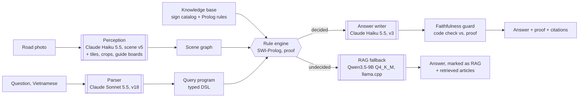

# SignCite: neuro-symbolic answers about Vietnamese traffic signs

[](https://github.com/lephuocloc1729/ns-vqa/actions/workflows/ci.yml)
[](https://github.com/lephuocloc1729/ns-vqa/actions/workflows/cd.yml)

SignCite answers questions about the traffic signs in a road photo ("Xe tải có được rẽ trái ở đây không?"), under
QCVN 41:2024/BGTVT and Law 36/2024/QH15, and shows the legal reasoning behind every answer.

- A vision model reads the signs into a **scene graph**.
- A language model turns the question into a small typed **query program**.
- A **Prolog rule engine** decides the answer from the two, and returns a **proof** with the articles it used.
- Claude only phrases the answer, and a code check rejects any wording that leaves the engine's verdict.
- A question the rules can't decide goes to a **retrieval-augmented model** (Qwen3.5-9B on a GPU), and its answer
  is marked as not verified by the rules.

**Live demo:** https://signcite.xyz (login for testers) · **Design:** [`DESIGN.md`](DESIGN.md) · **Record of every
step and number:** [`docs/status.md`](docs/status.md) · **Benchmark release notes:**
[`docs/release/v1.0-benchmark.md`](docs/release/v1.0-benchmark.md)

## Contents

- [Architecture](#architecture)
- [Results](#results)
- [What you need](#what-you-need)
- [Quick start with Docker](#quick-start-with-docker)
- [API and Swagger](#api-and-swagger)
- [Development and tests](#development-and-tests)
- [Repository layout](#repository-layout)
- [Reproducing the numbers](#reproducing-the-numbers)
- [Models and artifacts](#models-and-artifacts)
- [CI/CD and monitoring](#cicd-and-monitoring)
- [Hand-over](#hand-over)
- [Data and licences](#data-and-licences)

## Architecture



Double-bordered boxes are model calls. Perception and parsing run in parallel. The rule engine owns every legal
conclusion; the models only read the inputs and phrase the output.

**The services** (`docker-compose.yml`; containers talk over REST, and the answer streams to the browser as
server-sent events):

| Service | What it runs |
|---|---|
| `web` | nginx serving the React UI and the admin console, and proxying `/v1` to the API |
| `api` | FastAPI backend and API gateway: the pipeline, the Prolog engine, streaming, sessions, feedback, `/metrics` |
| `postgres` | users, sessions, chat history and feedback |
| `rag` (GPU profile) | the RAG inference server: retrieval over the law corpus (embeddings kept in the service) and Qwen3.5-9B |
| `rag-tunnel` | an SSH tunnel from the demo server to a rented GPU's RAG |
| `prometheus`, `node-exporter`, `grafana` | metrics and the dashboard "SignCite – hệ thống" |

## Results

The benchmark is the private test of VLSP 2025 MLQA-TSR (Natural QA version): 146 questions on 104 photos, run
3 times on the frozen system (tag `v1.0-benchmark`), every answer graded by hand.

| System | Private test |
|---|---|
| **V2: rules + RAG fallback** | **82.2%** (sd 1.8 over 3 runs) |
| V1: rules only | decides 66.9% of the questions, at 82.3% |
| RAG alone | 81.5% (119 of 146, hand-graded; judge 79.2%) |
| Baseline LowCost [1] | 77.4% (113 of 146, hand-graded) |
| Baseline LexiSignVQA [2] | 78.1% (114 of 146, hand-graded) |

**The baselines** are the two VLSP 2025 systems, adapted to free-text Natural QA answers and re-run for this
project with Qwen3.5-9B (BF16, greedy), the same answer model as the RAG. Each figure is the **best of 4 settings, picked on
the private test itself** (LowCost: 0, 1, 3 or 5 few-shot examples, best 5; LexiSignVQA: top-k 1, 2, 3 or 5, best
1), so it favours the baselines; V2 had no such choice. LowCost with Gemma 3 12B scored at most 73.3% (5-shot).

1. V. D. Anh, K. V. Tran, T. T. Ha, "A low-cost low-energy approach to VQA on traffic signs problems," in *Proc.
   VLSP 2025*, ACL, 2025, pp. 451–458. https://aclanthology.org/2025.vlsp-1.53/
2. P. X. Pham, D. Q. Le, T. H. Tran, T. N.-T. Huynh, "LexiSignVQA: A unified training-free multi-stage approach to
   multimodal legal question answering on traffic sign rules," in *Proc. VLSP 2025*, ACL, 2025, pp. 440–450.
   https://aclanthology.org/2025.vlsp-1.52/

- On the public test (100 questions) V2 scores 84.5%.
- **Every rules answer comes with a proof and law citations that cannot contradict it**, and the system answers
  "undecided" instead of guessing when a fact is missing.
- Red team (`docs/results/redteam-2026-11-24.md`): 30 of 30 attacks blocked, 0 of 40 normal questions refused.

**Inference optimisation: the RAG answer model, BF16 → Q4_K_M** (llama.cpp GGUF, one RTX 5090, 20 questions for
speed and memory; the private test for accuracy; `docs/results/gpu-session-2026-11-21.md`):

| | BF16 | **Q4_K_M** | Change |
|---|---|---|---|
| Peak GPU memory | 19.61 GB | **9.29 GB** | −10.3 GB (−53%) |
| Generation | 11.0 ms/token (91 tokens/s) | **4.9 ms/token** (203 tokens/s) | 2.2× faster |
| Time per answer | 6.48 s | **4.82 s** | −26% |
| Private accuracy, by hand | 81.5% | 81.5% | none |
| Private accuracy, judge | 84.6% | 79.2% | −5.4 points (the judge and the human grader disagree) |

**Latency and load:**

| What | Figure | Source |
|---|---|---|
| Real answer, private test (3 runs) | 16.5 / 18.5 / 21.1 s per question, about $0.009 | `eval/runs/e2e/private_aggregate_*.json` |
| RAG service, 1 slot | 8.6 s mean, 18.7 GB VRAM | `docs/results/rag-concurrency-2026-11-23.md` |
| Load, 10 answer slots (Locust, fake pipeline) | 10.33 answers/s; p95 ≤ 2 s up to 200 users; 0 failures up to 1,000 users | `docs/results/load-test-slots-2026-11-23.md`, `load-test-2026-11-22.md` |
| Real end-to-end load on the demo server | 10 users at once, 45 questions, 0 errors | `docs/results/load-test-real-2026-11-25.md` |

`main` has a few post-benchmark fixes (listed in `docs/status.md`) that were never scored on the private test. The
numbers above are those of the tag.

## What you need

What each way of running SignCite needs, and what it costs. Every paid command takes a `--max-spend` cap and stops
there; each Claude call is logged with its cost in `logs/api_calls.jsonl`.

| To do this | Anthropic API key | Claude cost | GPU | Data |
|---|---|---|---|---|
| Run the stack with the fake pipeline ([Quick start](#quick-start-with-docker)) | no | none | no | none |
| Run the tests, check the frozen system ([level 1](#1-what-anyone-can-check-no-dataset-no-key-no-cost)) | no | none | no | none |
| Use the real system (the demo, your own photos) | yes | about $0.01 per question; the first question on an idle server about $0.07 (the prompt cache is written) | only for the RAG fallback | the scene pictograms, built from the dataset |
| Re-run the public test, rules only ([level 2](#2-re-running-the-public-test-the-dataset-and-an-anthropic-key-about-065)) | yes | about $0.50 | no | the dataset (public test and `law_db`) |
| Add V2 and RAG alone on the public test | yes | about $0.14 more | only to regenerate the RAG's answers | the RAG's saved answers or its files (below) |
| Re-run the private test, rules only ([level 3](#3-re-running-the-private-test-the-private-test-files-a-key-and-for-v2-a-gpu)) | yes | about $1.35 | no | the private test files |
| Add V2 and RAG alone on the private test | yes | about $0.75 more | yes | the RAG's files (below) |

**An Anthropic API key.** The system calls Claude for perception (`claude-haiku-5-5`), question parsing
(`claude-sonnet-5-5`), the answer writer (`claude-haiku-5-5`) and, in evaluations, the judge (`claude-opus-5-5`).
1. Create an account at https://console.anthropic.com and add credits under Billing (the API is pay as you go; a
   few dollars covers every run above).
2. Create a key under API keys.
3. Give it to the process that runs SignCite, never to git:
   `export ANTHROPIC_API_KEY=sk-ant-...` for the scripts, or `ANTHROPIC_API_KEY=` in `.env` for Docker
   (`.env` is gitignored).

**A GPU, for the RAG only.** The RAG answer model (Qwen3.5-9B, Q4_K_M) needs an NVIDIA GPU with at least 24 GB of
memory; the service peaked at 18.7 GB in our runs. We rented an RTX 5090 on vast.ai by the hour, but any provider
with a 24 GB card and fast internet (the service downloads about 8 GB of model files and runtime at start) works. The GPU image
is public (`ghcr.io/lephuocloc1729/ns-vqa-rag`); how we set it up is in
[`docs/runbooks/gpu-session.md`](docs/runbooks/gpu-session.md), written for our vast.ai template.

**The data.**
- **The dataset** (VLSP 2025 MLQA-TSR, Natural QA version, with `law_db`) comes from the VLSP 2025 organisers under
  their data agreement. The private test files are part of it once the organisers release them to you.
- **The RAG's files** are not public. Its model weights are (Hugging Face; sources and sha256 in
  [`docs/release/v1.0-benchmark.md`](docs/release/v1.0-benchmark.md)), but its law corpus, few-shot bank and their
  embeddings are built from the dataset, so they fall under the same agreement. Our GPU set-up downloads them from
  a private Hugging Face dataset with a token. If you have the VLSP data, ask the authors for them; their files and
  sha256 are listed in `services/rag/assets_manifest.json`.

## Quick start with Docker

**On any clean machine with Docker** (no API key, no GPU, no `.env` file, no absolute paths). This starts the whole
stack with a fake pipeline: the real API, streaming, storage and monitoring, with sample answers and no Claude calls.

```bash
git clone https://github.com/lephuocloc1729/ns-vqa.git && cd ns-vqa
docker compose up -d --build
```

| Open | URL |
|---|---|
| The UI (a red banner marks the fake pipeline) | http://localhost:8080 |
| Swagger (API docs) | http://localhost:8080/docs |
| Grafana (`admin` / `admin`) | http://localhost:3000 |
| Prometheus | http://localhost:9090 |

Stop it with `docker compose down` (add `-v` to delete the stored data). CI starts this same stack on a clean
runner on every push.

**The real system, as on https://signcite.xyz,** needs an Anthropic API key, the dataset (for the scene prompt's
pictograms) and, only for the RAG fallback, a GPU (see [What you need](#what-you-need)).

1. Build the pictograms from the dataset's `law_db` (Python set-up as in [Development and tests](#development-and-tests);
   the copies are gitignored and never built into an image, and the API refuses to start in real mode without them):

   ```bash
   for v in v5 v5-crop v5-tile; do .venv/bin/python tools/build_scene_pictograms.py --version $v; done
   ```

2. Copy `.env.example` to `.env` (gitignored) and set, as the demo server does:

   ```bash
   ANTHROPIC_API_KEY=sk-ant-...
   VQA_SPEND_LIMIT=5              # USD per API process; answers stop above it
   VQA_ANSWER_SLOTS=10            # questions answered at once
   VQA_ANSWER_FALLBACK=off        # rag when a GPU runs the RAG, with VQA_RAG_URL pointing at it
   POSTGRES_PASSWORD=<a new one>
   GRAFANA_ADMIN_PASSWORD=<a new one>
   ```

3. Start the stack with the overlay that switches the API to the real pipeline and mounts the pictograms:

   ```bash
   docker compose -f docker-compose.yml -f docker-compose.real.yml up -d --build
   ```

The UI is at http://localhost:8080, Swagger at `/docs`, Grafana at http://localhost:3000. Follow-up questions are on
by default. For the rest of what the public site has, see [`docs/deploy.md`](docs/deploy.md): HTTPS on a domain
(`DOMAIN` and `docker-compose.https.yml`), a shared tester password (`BASIC_AUTH_USER`, `BASIC_AUTH_PASSWORD`), the
admin site (`ADMIN_PASSWORD`), and connecting a rented GPU for the RAG fallback
([`docs/runbooks/gpu-session.md`](docs/runbooks/gpu-session.md)). The demo server is a 2-vCPU, 4 GB machine; the
model calls run at Anthropic and on the GPU.

## API and Swagger

The API documents itself: Swagger UI at `/docs` and the OpenAPI schema at `/openapi.json` on a running stack.

| Endpoint | What |
|---|---|
| `POST /v1/ask` | a photo and a question → the answer, its proof, citations and sign boxes |
| `POST /v1/ask/stream` | the same as server-sent events: `started`, `perception`, `parsed`, `engine`, `route`, `token`…, `answer`, `done` |
| `POST /v1/sessions`, `GET /v1/sessions/{id}/turns` | conversations and their history |
| `GET /v1/turns/{id}` | one stored answer (a dropped stream recovers from here) |
| `POST /v1/turns/{id}/feedback` | thumbs up or down, a corrected answer, a note |
| `GET /v1/images/{sha256}` | a stored photo |
| `/v1/admin/…` | the admin console: overview, questions, feedback and CSV export, accounts, live settings, GPU connection |
| `GET /health`, `GET /version`, `GET /metrics` | health, the running profile, Prometheus metrics |

## Development and tests

Python 3.11+ and SWI-Prolog 9.1+ (`brew install swi-prolog`):

```bash
python3.11 -m venv .venv
.venv/bin/python -m pip install -e '.[dev,api,eval]'
swipl -q -g "consult('kb/load.pl'), halt"         # the Prolog knowledge base loads on its own
.venv/bin/python -m pytest -q                     # no API calls; 94% line coverage of vqa/ and app/ in CI, 95% locally
cd web && npm install && npx vitest run && npx playwright test
```

| Tests | What they cover |
|---|---|
| pytest, over 2,600 cases | each rule family on hand-written scenes, the parser and its validator, perception, the pipeline, the API (every route, SSE order, errors), the admin site, the leakage guard, follow-ups, the readable proof |
| Vitest | the SSE parser, the turn reducer, admin formatting |
| Playwright | the UI on desktop and phone against the real API with a fake pipeline |
| `services/rag/tests/` | the RAG service |
| Locust (`eval/load/`) | capacity and stress runs, through the "Load test" workflow |

Tests that need the local dataset are skipped in CI (`tests/needs_local_data.txt`). If `janus-swi` fails to build,
put `SWI_HOME_DIR=/opt/homebrew/lib/swipl` in front of the pip command.

## Repository layout

| Folder | Content |
|---|---|
| `vqa/` | the pipeline: perception, question parser, rule engine bridge, answer writer and faithfulness guard |
| `kb/` | the knowledge base: the sign catalog and the Prolog rules, each citing its law article |
| `prompts/` | versioned prompts and few-shot examples |
| `app/api/` | the FastAPI backend: streaming, storage, admin site, follow-up questions, readable proofs |
| `web/` | the React UI and the admin console |
| `services/rag/` | the RAG service (retrieval over the law corpus and few-shot bank, Qwen3.5-9B through llama.cpp) |
| `eval/` | evaluation: splits, judge, benchmark runners, freeze records, load tests, red team, UAT pack |
| `docker/`, `docker-compose*.yml` | the stack: nginx, API, Postgres, Prometheus, Grafana, RAG tunnel, RAG |
| `tests/` | the test suite: one file per rule family, plus the API, UI back end and evaluation tools |
| `tools/` | offline authoring tools (catalog drafting, pictograms) |
| `docs/` | `status.md` (the record of every step and number), `plans/`, `results/`, `release/`, `deploy.md`, `runbooks/` |

### The standard layout, mapped

| Standard folder | Here |
|---|---|
| `src/` | `vqa/` (the pipeline), `app/` (the API), `services/rag/` (the RAG service), `web/` (the UI) |
| `tests/` | `tests/`; also `web/src/**/*.test.ts` and `web/e2e/` for the UI, and `services/rag/tests/` |
| `configs/` | `kb/` (the catalog and the engine switches, e.g. `kb/switches_48.yaml`), `prompts/<stage>/<version>/config.yaml`, `eval/frozen_phase52.json` (the frozen system's settings), `.env.example`, and `docker/` (nginx, Prometheus, Grafana) |
| `docker/` | `docker/` and `docker-compose*.yml` |
| `docs/` | `docs/`, `DESIGN.md`, and the Swagger docs at `/docs` on a running API |

The folders keep their names on purpose. The benchmark's freeze record (`eval/frozen_phase52.json`) fingerprints
the engine by hashing every file under `vqa/` and `kb/` together with its path. At the tag `v1.0-benchmark`,
`eval/freeze.py check --profile phase52` passes, which shows that the tagged code is the code that was benchmarked.
`main` has post-benchmark fixes, so the check reports a different fingerprint there, as it should. Keeping the same
folders keeps `main` and the tag directly comparable, file by file.

## Reproducing the numbers

There are three levels. The first needs nothing; the second needs the dataset and a paid API key; the third also
needs the private test files and, for V2, a GPU.

### 1. What anyone can check (no dataset, no key, no cost)

```bash
git clone https://github.com/lephuocloc1729/ns-vqa.git && cd ns-vqa
python3.11 -m venv .venv && .venv/bin/python -m pip install -e '.[dev,api,eval]'

.venv/bin/python -m pytest -q                               # on main; tests that need the dataset are skipped
docker compose up -d --build                                # the whole stack, fake pipeline (see Quick start)

git checkout v1.0-benchmark                                 # the code of the 3 private runs
.venv/bin/python eval/freeze.py check --profile phase52     # prints "matches the freeze record"
```

- The freeze check proves that the tagged code, prompts and settings are the ones in the freeze record
  (`eval/frozen_phase52.json`): it hashes every file under `vqa/` and `kb/` and every prompt version it names.
- Each private run left a committed record: `eval/private_ran.json`, `_2.json`, `_3.json` (rules only) and
  `eval/private_rag_ran*.json` (with the RAG). Each gives the git commit it ran from, the sha256 of the freeze
  record it ran under, its start and finish times and what it spent. The scores themselves are in
  [`docs/status.md`](docs/status.md).

### 2. Re-running the public test (the dataset and an Anthropic key, about $0.65)

1. Get the dataset (`VLSP2025-MLQA-Natural/`) from the VLSP 2025 organisers and put it at the repository root, or
   set `VQA_DATASET_DIR`. It is not in this repository.
2. Build the scene prompt's reference pictograms from the dataset's `law_db` (the copies are gitignored; the
   committed `pictograms.yaml` manifests check them by sha256, and perception refuses copies that don't match):

   ```bash
   for v in v5 v5-crop v5-tile; do .venv/bin/python tools/build_scene_pictograms.py --version $v; done
   ```

3. Check out the commit the public_dev run used, confirm it is the frozen system, and run it. Every paid script
   stops at its `--max-spend`:

   ```bash
   git checkout 59425af
   .venv/bin/python eval/freeze.py check --profile phase52
   export ANTHROPIC_API_KEY=...
   .venv/bin/python eval/e2e_public_dev52.py run --confirm-frozen --max-spend 1.2
   ```

   This answers the 51 public_dev questions with the rules only (V1), with fresh perception, and grades them with
   the judge (`eval/prompts/judge/v1`). The reported run cost $0.50.
4. For V2 and RAG alone, merge with the RAG's saved public-test answers (about $0.14 for the judge):

   ```bash
   .venv/bin/python eval/e2e_public_dev52.py merge --run-id <the run's id> --max-spend 0.6 \
       --rag-predictions <RAG>/answer_comparison/public_configs_C/public_test/predictions.jsonl
   ```

   The RAG's saved public-test answers are not in this repository; ask the authors for them. To produce them again,
   run the RAG's batch runner on a GPU with `--split public_test` and the evaluation bundle (`gpu_setup.sh --eval`;
   see [`docs/runbooks/gpu-session.md`](docs/runbooks/gpu-session.md)). The bundle is private because it holds
   public-test files.

The public_holdout half (the other 49 questions) ran the same way from a local branch with the same frozen system.

### 3. Re-running the private test (the private test files, a key and, for V2, a GPU)

The private test files come from the VLSP 2025 organisers; they are not in this repository. The three benchmark
runs are final: `eval/e2e_private.py run` and `eval/e2e_private_rag.py run` refuse once a run's record exists, so
the benchmark could not be re-tried and the best run reported. To re-run it, use the **reproduction mode**. It keeps
every other guard (the frozen system, a clean tree, the question and image counts, a gitignored replay folder),
never reads or writes the benchmark's records, and can run any number of times. It runs from the tag
`v1.0-benchmark-repro`: the benchmarked code with this mode added in `eval/` only, so the freeze check still passes.

1. Set up as in level 2 (the dataset, including the private test files, the pictograms and `ANTHROPIC_API_KEY`), then:

   ```bash
   git checkout v1.0-benchmark-repro
   .venv/bin/python eval/freeze.py check --profile phase52        # "matches the freeze record"
   .venv/bin/python eval/e2e_private.py reproduce --confirm-frozen --max-spend 3
   ```

   This is V1, rules only, on the 146 private questions (about $1.35 with the judge). It prints a counter only and
   writes the aggregate `eval/runs/reproduce/private_reproduce_repro-<id>.json`; the replay records stay in the
   gitignored `cache/private_run/repro-<id>/`.
2. For V2 and RAG alone, write the triggered question ids, answer them live with the RAG on a GPU, and merge (about
   $0.75 for the judge):

   ```bash
   .venv/bin/python eval/e2e_private_rag.py ids --reproduce repro-<id>
   # on the GPU machine, with the RAG service from services/rag/ on main (docs/runbooks/gpu-session.md):
   #   experiments/private_live/run_private_live.sh <triggered_ids.json>   ->  rag_live.jsonl
   .venv/bin/python eval/e2e_private_rag.py run --reproduce repro-<id> --confirm --max-spend 1 \
       --rag-predictions <RAG>/private_test/predictions.jsonl --rag-live <RAG>/outputs/private_live/rag_live.jsonl
   ```

   The aggregate goes to `eval/runs/reproduce/private_rag_reproduce_repro-<id>.json`.

Two things a re-run can't give:
- **The private answers stay unreleased.** Only the scoring code reads them, in memory, and it writes aggregates
  only (dataset rules in [`CLAUDE.md`](CLAUDE.md)).
- **The reported private scores are graded by hand** by the author. A re-run gives the judge's grade, which is
  close but not the same (for V2 the two agree within 0.1 point; for RAG alone, 79.2% by the judge against 81.5% by
  hand). A grading sheet for your own hand grading is written in the run's replay folder.

### What a re-run should match

Perception, parsing and the writer are model calls whose output varies between runs. That is why the private test
was run 3 times and is reported as a mean and spread (V2 82.2%, sd 1.8). A re-run should land within that spread,
not on the exact number. The RAG with one answer slot repeats exactly (24 of 24 answers, on two days and two
machines).

### Settings, seeds and versions

All of them are committed:
- the frozen system's settings in `eval/frozen_phase52.json`: perception `claude-haiku-5-5` with scene prompt v5,
  tiles, crops and guide-board reading, no re-run; parser `claude-sonnet-5-5` (effort medium) with prompt v18;
  writer v3; reading policy `higher_confidence`; context year 2025;
- each prompt's model and settings in `prompts/<stage>/<version>/config.yaml`, with the prompt version in every
  cache key and result;
- the splits and their seeds: `data/splits/public_split.json` (seed 20261114) and `data/splits/train_validation.json`
  (seed 20261116);
- the RAG's model files and runtime with their sha256 in [`docs/release/v1.0-benchmark.md`](docs/release/v1.0-benchmark.md).

| Number | How it was produced | Record |
|---|---|---|
| Private test, V1 (3 runs) | `eval/e2e_private.py run [--run 2\|3]` at `v1.0-benchmark` | `eval/private_ran*.json`; scores in `docs/status.md` |
| Private test, V2 and RAG alone | `eval/e2e_private_rag.py run --run N …` (above) | `eval/private_rag_ran*.json`; scores in `docs/status.md` |
| Private test, a re-run | `eval/e2e_private.py reproduce`, then `eval/e2e_private_rag.py run --reproduce …` at `v1.0-benchmark-repro` (level 3) | `eval/runs/reproduce/` (your own) |
| Public test, V2 | `eval/e2e_public_dev52.py run`, then `merge` (level 2) | `docs/status.md`, "phase52 on the whole public test" |
| Load tests | GitHub Actions › Load test (Locust, fake pipeline) | `docs/results/load-test-*.md` |
| RAG speed, memory, Q4 vs BF16 | `eval/rag_bench.py` on a GPU session | `docs/results/gpu-session-2026-11-21.md`, `rag-concurrency-2026-11-23.md` |
| Red team | `eval/redteam/redteam.py run --max-spend 0.65`, then `rag` and `report` | `docs/results/redteam-2026-11-24.md` |

## Models and artifacts

| Artifact | Where |
|---|---|
| Claude models | `claude-haiku-5-5` and `claude-sonnet-5-5` through the Anthropic API (ids and prompt versions in `eval/frozen_phase52.json`) |
| RAG answer model | Qwen3.5-9B, Q4_K_M GGUF, public on Hugging Face; source, revision and sha256 in the release notes |
| RAG embeddings | F2LLM-v2 0.6B (queries) and BGE-M3 (the corpus embeddings), public on Hugging Face |
| RAG runtime assets | `services/rag/assets_manifest.json` (1,596 files with sha256), fetched by `services/rag/scripts/fetch.py` |
| GPU image | `ghcr.io/lephuocloc1729/ns-vqa-rag` (public; code only), built by the "RAG GPU image" workflow |
| The knowledge base | `kb/`: the sign catalog and the Prolog rules, in this repository |
| The benchmarked code | tag `v1.0-benchmark` (`4e71a18`) and its GitHub release |

SignCite trains no weights of its own: its "model" is the knowledge base plus the versioned prompts, both in this
repository. The dataset and any data derived from it are not published (see below).

## CI/CD and monitoring

- **CI** (`.github/workflows/ci.yml`, on every push): lint, the Prolog knowledge base load, the leakage guard, the
  test suite with coverage; the RAG service tests; the web typecheck, unit tests and build; Playwright end to end;
  and the Docker Compose stack on a clean runner. JUnit and coverage reports are uploaded with each run.
- **CD** (`.github/workflows/cd.yml`, after CI passes on `main`): builds the images, pushes them to GHCR, deploys
  to the demo server over SSH, checks the stack, and **rolls back by itself** if the check fails.
- **Other workflows:** the API base image, the RAG GPU image, the load test.
- **Monitoring:** Prometheus scrapes the API's `/metrics` and node-exporter; the Grafana dashboard
  "SignCite – hệ thống" shows answers by route, Claude cost, answer time p50/p95 and time to each stage, feedback,
  failed requests, and server CPU and memory. Each Claude call's tokens and cost are logged per stage.

## Hand-over

| Item | Where |
|---|---|
| Source code | this repository; the benchmarked code at tag `v1.0-benchmark` |
| Live demo | https://signcite.xyz |
| Benchmark release | the GitHub release `v1.0-benchmark`, notes in [`docs/release/v1.0-benchmark.md`](docs/release/v1.0-benchmark.md) |
| Thesis (PDF), slides (PPTX, PDF) and demo video | submitted to the faculty, not kept in this repository; the video's script is [`docs/defense/demo_video_script.md`](docs/defense/demo_video_script.md) |

## Data and licences

The dataset, its images and the law corpus figures are not redistributed here; the VLSP data agreement applies. The
RAG's model weights are public upstream (Qwen3.5-9B GGUF, F2LLM-v2 0.6B, BGE-M3); `services/rag/assets_manifest.json`
lists the RAG's own files with their sha256.
